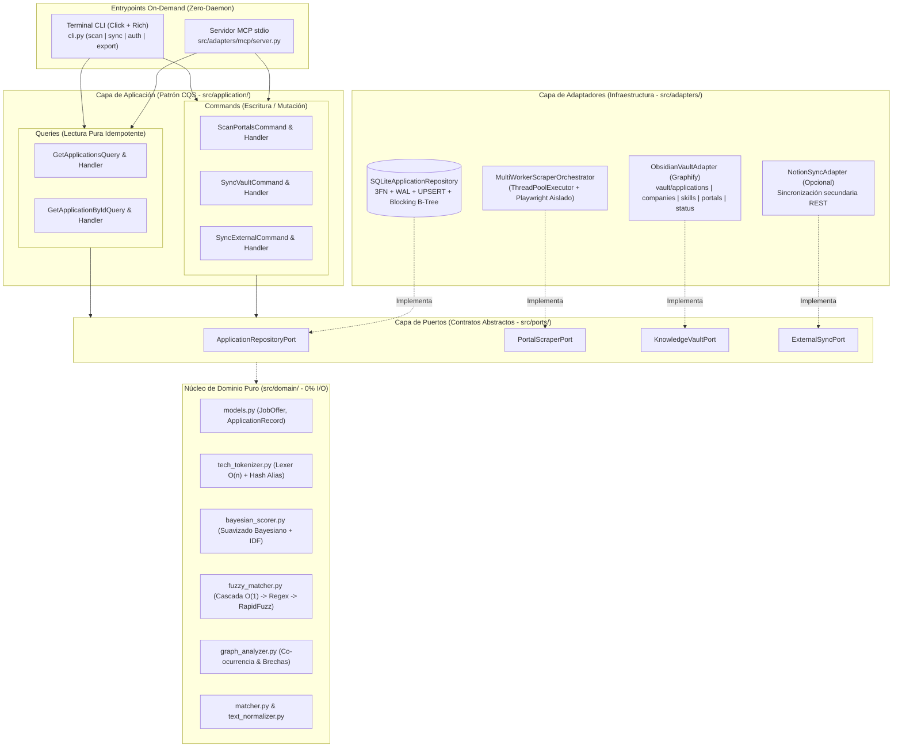

# jobOS-bot v2.0

> **Motor Concurrente de Inteligencia Laboral en Python 3.11+ con Clean Architecture, Patrón CQS, Scraping Multi-Worker en Playwright, Base de Datos en Grafo Local (Obsidian + Graphify) y Activación Zero-Daemon On-Demand via MCP.**


`jobOS-bot v2.0` es una unidad táctica de inteligencia laboral **On-Demand** que rastrea concurrentemente múltiples portales de empleo (`LinkedIn`, `GetOnBrd`, `Computrabajo`, `Elempleo`, `Glassdoor`, `Indeed`), evalúa compatibilidad mediante tokenización en $O(n)$ y suavizado bayesiano (`Match >= 40%`), deduplica ofertas con índices B-Tree compuestos en SQLite y construye automáticamente un **Grafo de Conocimiento Local en Obsidian (`vault/`)** listo para explorar con **Graphify** y aplicar con un solo clic (**Click-and-Apply**).

---

## 1. Arquitectura v2.0: Clean Architecture + CQS + Multi-Worker + Obsidian Vault



---

## 2. Pilares Técnicos y Algorítmicos de la v2.0

### A. Activación Zero-Daemon On-Demand via MCP (`src/adapters/mcp/server.py`)
El sistema tiene **costo cero de CPU/RAM en reposo**. Se activa únicamente cuando tu asistente de IA (`Claude Desktop`, `Cursor`, `Antigravity`) invoca una de sus **3 herramientas MCP** o cuando ejecutas la CLI:
1. **`run_portal_scan_and_sync`**: Despacha el pool multi-worker concurrente, filtra vacantes (`match_score >= 40%`), persiste en SQLite con `UPSERT` atómico y sincroniza los nodos Markdown en el Vault de Obsidian.
2. **`query_job_applications`**: Consulta analítica de solo lectura (`GetApplicationsQuery`) filtrando por estado, puntaje mínimo o portal.
3. **`sync_obsidian_vault`**: Reconstruye íntegramente el grafo de Obsidian (`vault/`) desde SQLite (`SyncVaultCommand`).

### B. Orquestación Multi-Worker Concurrente (`MultiWorkerScraperOrchestrator`)
* Ejecuta múltiples portales en paralelo mediante `ThreadPoolExecutor` (`--workers 4`).
* Cada worker instancia su propio contexto aislado de Playwright para evitar condiciones de carrera y colisiones de sesión, manteniendo *graceful degradation* si un portal falla o presenta bloqueo.

### C. Motores Algorítmicos de Dominio (`src/domain/`)
* **`TechTokenizer` ($O(n)$)**: Extrae tecnologías en una sola pasada preservando símbolos (`C#`, `C++`, `.NET`, `Node.js`) y resolviendo sinónimos en $O(1)$ mediante tabla hash, eliminando los falsos positivos de `\b` en motores regex NFA.
* **Hard Rejects Exclusivos en Título**: Los descartes duros (`Senior`, `Lead`, `Architect`, `+5 años`) se evalúan únicamente sobre el título del cargo, nunca sobre el cuerpo descriptivo.
* **`BayesianScorer` (Suavizado Bayesiano + IDF)**: Calcula el score ponderando evidencia con prior $p_0$, parámetro $\alpha$ e Inverse Document Frequency ($IDF(t)$) para premiar tecnologías distintivas sin saltos discontinuos.
* **`FuzzyCascadeMatcher`**: Cascada de resolución en 3 etapas: Hash Exacto $O(1)$ $\rightarrow$ Plantillas parametrizadas Regex $O(L)$ $\rightarrow$ `RapidFuzz` con poda de Ukkonen (`score_cutoff >= 85%`).
* **`GraphAnalyzer`**: Proyecta la red bipartita Vacante $\leftrightarrow$ Skill en un grafo de co-ocurrencia Skill-to-Skill y calcula la prioridad de aprendizaje $\text{Prioridad}(s) = \text{Demanda}(s) \times (1 - \text{Dominio}(s))$.

### D. Grafo Local en Obsidian + Graphify (`src/adapters/obsidian/`)
Cada oferta genera una nota rica en `vault/applications/` con propiedades YAML y `[[Wikilinks]]` bidireccionales hacia nodos hub (`vault/companies/`, `vault/skills/`, `vault/portals/`, `vault/status/`), permitiendo identificar clústeres de mercado en **Graphify** y postular directamente mediante enlaces canónicos limpios (**Click-and-Apply**).

---

## 3. Matriz de Comandos Nucleares de CLI (`cli.py`)

| Comando | Propósito | Ejemplo de Uso |
| :--- | :--- | :--- |
| **`scan`** | Escaneo concurrente multi-worker, filtrado y sincronización con Obsidian Vault. | `python cli.py scan --portal linkedin,getonbrd --workers 4 --limit 15 --vault-dir vault` |
| **`sync`** | Reconstruye el grafo en Obsidian (`--target obsidian`) o sincroniza con Notion (`--target notion`). | `python cli.py sync --target obsidian --vault-dir vault` |
| **`auth`** | Abre el navegador visible para iniciar sesión manual y exportar cookies (`storage_state.json`). | `python cli.py auth --portal linkedin` |
| **`export`** | Exporta el histórico de postulaciones desde SQLite a `json` o `csv`. | `python cli.py export --format json --output exports/jobs.json` |

---

## 4. Estructura Real del Proyecto

```text
jobOS-bot/
├── cli.py                                      # CLI (Click + Rich) con los 4 comandos: scan, sync, auth, export
├── requirements.txt                            # Dependencias de producción, mypy y pytest
├── pyproject.toml                              # Configuración de proyecto v2.0, pytest y mypy --strict
├── Dockerfile                                  # Imagen oficial Playwright Python lista para producción
├── docker-compose.yml                          # Contenedor con volúmenes para data/, vault/ y exports/
├── .env.example                                # Variables de entorno (DB_PATH, VAULT_PATH, HEADLESS, NOTION_*)
├── config/
│   ├── filters.yaml                            # Reglas declarativas, tech_keywords y pesos de scoring
│   ├── profile.example.yaml                    # Plantilla de perfil del candidato
│   └── cv_base.example.md                      # Plantilla de CV base en Markdown
├── docs/
│   ├── arquitectura/                           # Arquitectura v2.0 (11-redefinicion-cqs-obsidian-multiworker.md)
│   ├── logica-negocio/                         # Reglas de scoring, deduplicación y flujo Click-and-Apply
│   └── base-de-datos/                          # Modelo 3FN, índices B-Tree compuestos y normalización
├── src/
│   ├── config_loader.py                        # Cargador tipado de YAML y configuración de entorno
│   ├── domain/                                 # CAPA DE DOMINIO PURO (0% I/O)
│   │   ├── models.py                           # Dataclasses inmutables (JobOffer, ApplicationRecord, etc.)
│   │   ├── text_normalizer.py                  # Normalización Unicode NFD, URLs canónicas y dedup_key
│   │   ├── tech_tokenizer.py                   # Tokenizador O(n) con diccionario hash de alias tecnológicos
│   │   ├── bayesian_scorer.py                  # Suavizado bayesiano con prior p_0 e IDF por tecnología
│   │   ├── fuzzy_matcher.py                    # Cascada O(1) -> Regex Slots -> RapidFuzz (>= 85%)
│   │   ├── graph_analyzer.py                   # Co-ocurrencia Skill-to-Skill y priorización de brechas
│   │   └── matcher.py                          # Evaluación de Hard Rejects en título y Match % (>= 40%)
│   ├── ports/                                  # CAPA DE PUERTOS (Interfaces Abstractas ABC)
│   │   ├── repository_port.py                  # ApplicationRepositoryPort
│   │   ├── scraper_port.py                     # PortalScraperPort
│   │   ├── vault_port.py                       # KnowledgeVaultPort
│   │   └── external_sync_port.py               # ExternalSyncPort
│   ├── application/                            # CAPA DE APLICACIÓN (Patrón CQS)
│   │   ├── commands/                           # ScanPortalsCommand, SyncVaultCommand, SyncExternalCommand
│   │   ├── queries/                            # GetApplicationsQuery, GetApplicationByIdQuery
│   │   └── handlers/                           # Handlers desacoplados para cada Command y Query
│   └── adapters/                               # CAPA DE ADAPTADORES (Infraestructura Concreta)
│       ├── db/
│       │   ├── schema.sql                      # DDL 3FN + índice B-Tree compuesto (company_norm, title_norm)
│       │   └── repository.py                   # SQLiteApplicationRepository (UPSERT + Blocking difuso)
│       ├── obsidian/
│       │   ├── adapter.py                      # ObsidianVaultAdapter (generación del grafo local)
│       │   ├── frontmatter.py                  # Serializador YAML frontmatter
│       │   ├── wikilinks.py                    # Generador de enlaces [[Wikilinks]]
│       │   └── hubs.py                         # Creador de nodos hub (companies, skills, portals, status)
│       ├── scrapers/
│       │   ├── orchestrator.py                 # MultiWorkerScraperOrchestrator (ThreadPoolExecutor)
│       │   ├── base.py                         # BasePortalScraper (Template Method)
│       │   ├── browser.py                      # Gestión de contextos Playwright aislados por worker
│       │   ├── linkedin.py                     # Scraper LinkedIn Jobs
│       │   ├── getonbrd.py                     # Scraper GetOnBrd
│       │   ├── computrabajo.py                 # Scraper Computrabajo
│       │   ├── elempleo.py                     # Scraper Elempleo
│       │   ├── glassdoor.py                    # Scraper Glassdoor
│       │   └── indeed.py                       # Scraper Indeed
│       ├── mcp/
│       │   └── server.py                       # Servidor MCP On-Demand (3 tools conectadas a CQS)
│       └── notion/
│           └── notion_client.py                # NotionSyncAdapter (ExternalSyncPort secundario)
└── tests/                                      # SUITE DETERMINISTA F.I.R.S.T. (Pytest + mypy --strict)
    ├── test_v2_architecture.py
    ├── test_cli.py
    ├── test_mcp_server.py
    ├── test_matcher.py
    ├── test_repository.py
    ├── test_scrapers.py
    ├── test_text_normalizer.py
    └── test_notion_client.py
```

---

## 5. Inicio Rápido y Configuración MCP

### Instalación Local
```bash
python -m venv .venv
source .venv/bin/activate  # En Windows: .venv\Scripts\activate
pip install -r requirements.txt
playwright install chromium
cp .env.example .env
```

### Configuración del Servidor MCP On-Demand (`claude_desktop_config.json` / `mcp_config.json`)
```json
{
  "mcpServers": {
    "jobos-bot": {
      "command": "python",
      "args": ["-m", "src.adapters.mcp.server"],
      "cwd": "/ruta/absoluta/a/jobOS-bot"
    }
  }
}
```

### Ejecución de Tests y Verificación de Tipado Estricto
```bash
pytest -v
mypy --strict src cli.py tests
```

---

## 6. Documentación Técnica (`docs/`)

* **Documento Maestro v2.0:** [**11. Redefinición Arquitectónica v2.0: Clean Architecture, CQS, Multi-Worker, Grafo en Obsidian y Activación On-Demand via MCP**](./docs/arquitectura/11-redefinicion-cqs-obsidian-multiworker.md)
* [**Índice de Arquitectura (`docs/arquitectura/`)**](./docs/arquitectura/README.md)
* [**Índice de Lógica de Negocio (`docs/logica-negocio/`)**](./docs/logica-negocio/README.md)
* [**Índice de Base de Datos y Normalización (`docs/base-de-datos/`)**](./docs/base-de-datos/README.md)
* [**Guía de Convenciones para Agentes (`CLAUDE.md`)**](./CLAUDE.md)
