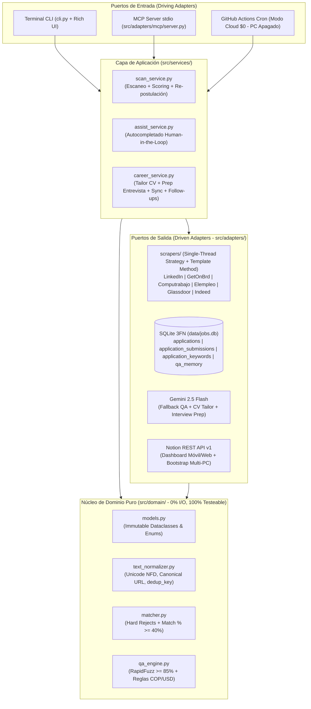

# jobOS-bot

> **Copiloto en Python con Arquitectura Hexagonal para extracción multi-portal de vacantes, scoring ponderado de compatibilidad, autocompletado asistido de formularios, preparación técnica de entrevistas y Servidor MCP (`Model Context Protocol`).**


`jobOS-bot` automatiza el flujo completo de búsqueda y postulación a empleos de ingeniería de software (**Entry-Level / Junior**: `React`, `Node.js`, `NestJS`, `TypeScript`, `PostgreSQL`) en modalidad **Remota o Híbrida/Presencial (Barranquilla / Colombia)**.

Está diseñado con un doble propósito:
1. **Herramienta personal de alta efectividad diaria:** Corre tanto de forma interactiva en Windows 11 como de forma **desatendida con tu PC apagado a costo \$0.00/mes** mediante GitHub Actions, Docker y Notion.
2. **Proyecto de Ingeniería de Software para Portafolio:** Construido bajo principios estrictos de **Clean Code, DRY, KISS, YAGNI**, tipado estático fuerte (`@dataclass(frozen=True, slots=True)`, `StrEnum`, `Literal`), base de datos relacional en **Tercera Forma Normal (3FN)**, servidor **MCP** nativo y suite de pruebas unitarias deterministas (**F.I.R.S.T.** con `pytest`).

---

## 1. Arquitectura General del Sistema (Hexagonal Ports & Adapters)



---

## 2. Reglas de Negocio Centrales

### A. Postulación por Rango de Compatibilidad (`Match >= 40%`)
El bot **no exige cumplir el 100% de los requisitos** de una oferta para postular:
* **Hard Rejects (`0%`):** Si el título exige `Senior`, `Lead`, `Architect`, `+5 años` o tecnologías 100% ajenas (`.NET`, `PHP`, `COBOL`, `SAP`), descarta la oferta de inmediato sin abrir el detalle.
* **Scoring Ponderado (`Match %`):** Cruza los requisitos de la oferta contra tu perfil asignando pesos (`3 pts` Core Stack: `React`, `Node.js`, `NestJS`, `TypeScript`, `JavaScript`, `PostgreSQL`; `2 pts` Secundarias; `1 pt` Complementarias).
* **Disparo Inteligente (`>= 40%`):** Si la oferta alcanza al menos **`40%` de compatibilidad**, **el bot envía la hoja de vida y se postula de todos modos**, registrando tanto las tecnologías que coincidieron (`is_matched = 1`) como los requisitos faltantes (`is_matched = 0`) para preparar tu entrevista.

### B. Re-Postulación con Registro Único (`times_applied` en 3FN)
Cuando una empresa republica la misma oferta días después o la publica en varios portales a la vez:
1. El normalizador genera una clave semántica única (`dedup_key = company_norm::title_norm`, ej. `globant::desarrollador full stack junior react node`).
2. Si cumple la política de re-postulación (portal distinto o enfriamiento cumplido y el estado no es *Entrevista* ni *Rechazado*), **el bot vuelve a enviar la hoja de vida**.
3. **Nunca duplica la fila en SQLite ni en Notion:** Actualiza el mismo registro maestro incrementando **`times_applied = times_applied + 1`**, registra el intento en la tabla hija `application_submissions` y actualiza la propiedad `Veces Postulado` en Notion.

### C. Copiloto de Formularios *Human-in-the-Loop* (`qa_memory`)
* Compara cada `<label>` del formulario contra tu memoria local en SQLite usando `RapidFuzz` (`< 0.5 ms`).
* Si la similitud es **`>= 85%`**, rellena el campo al instante y pinta un **borde verde**.
* Si es **`< 85%`**, consulta `gemini-2.5-flash` con tu `profile.yaml` (detectando automáticamente si el salario se pide en **COP** o **USD**), rellena la sugerencia con un **borde amarillo de revisión** y **se detiene antes de *Submit*** para que tú des el clic final.

---

## 3. Stack Tecnológico Completo

| Capa | Tecnología | Propósito |
| :--- | :--- | :--- |
| **Lenguaje** | **Python 3.11+** (`dataclasses`, `typing`, `enum`) | Código tipado de extremo a extremo, sin uso de `Any` entre capas. |
| **Scraping Multi-Portal** | **Playwright** (`playwright`) | Ejecución *single-thread* secuencial sobre 6 portales con pausas humanas (`2.5s–6.0s`). |
| **Base de Datos** | **SQLite 3** (`sqlite3` nativo en 3FN + `WAL`) | 4 tablas normalizadas (`applications`, `application_submissions`, `application_keywords`, `qa_memory`). |
| **Similitud y Reglas** | **RapidFuzz** + **Regex** + **PyYAML** | Matching difuso en microsegundos y reglas declarativas en `config/filters.yaml`. |
| **Inteligencia Artificial** | **Google GenAI SDK** (`gemini-2.5-flash`) | Respuestas a preguntas inéditas, adaptación de CV (`tailor`) y guías de entrevista (`prep`). |
| **Dashboard & Multi-PC** | **Notion REST API v1** (`httpx`) | Sincronización *Push/Pull* y *Bootstrap* automático al clonar el repo en otro PC. |
| **Agentes de IA** | **MCP SDK** (`mcp` / `FastMCP` via `stdio`) | Expone 5 herramientas para consultar tu base de datos desde Claude / Antigravity / Cursor. |
| **Interfaz CLI** | **Rich** (`rich`) | Tablas, barras de progreso y paneles en consola. |
| **Testing & DevOps** | **Pytest** + **Docker** + **GitHub Actions** | Tests unitarios F.I.R.S.T. en `:memory:`, contenedor reproducible y ejecución Cloud a **\$0/mes**. |

---

## 4. Estructura del Proyecto

```text
jobOS-bot/
├── cli.py                                  # Punto de entrada único CLI
├── requirements.txt                        # 8 dependencias de producción + pytest
├── pyproject.toml                          # Configuración de pytest y tipado
├── Dockerfile                              # Contenedor oficial Playwright Python
├── docker-compose.yml                      # Ejecución aislada con volúmenes persistentes
├── .env.example                            # Plantilla pública de variables de entorno
├── .gitignore                              # Bloqueo estricto de datos privados y sesiones
├── .github/workflows/
│   ├── ci.yml                              # Ejecuta pytest en cada push
│   └── scheduled_scan.yml                  # Corre el bot gratis ($0) con el PC apagado
├── config/
│   ├── filters.yaml                        # Whitelists, blacklists y pesos de Match % (>= 40%)
│   ├── profile.example.yaml                # Plantilla pública de perfil del candidato
│   └── cv_base.example.md                  # Plantilla pública de CV base en Markdown
├── docs/
│   ├── arquitectura/                       # 11 documentos de arquitectura, patrones y Gitflow
│   ├── logica-negocio/                     # 5 documentos de reglas de negocio y scoring
│   └── base-de-datos/                      # 3 documentos de modelo 3FN, DDL y normalización
├── src/
│   ├── config_loader.py                    # Cargador tipado de YAML y variables de entorno
│   ├── domain/                             # NÚCLEO PURO (0% I/O, 0% Red)
│   │   ├── models.py                       # @dataclass(frozen=True, slots=True), StrEnum
│   │   ├── text_normalizer.py              # Limpieza Unicode NFD, URL canónica y dedup_key
│   │   ├── matcher.py                      # Evaluación Hard Rejects y cálculo Match %
│   │   └── qa_engine.py                    # RapidFuzz (>= 85%) y reglas COP vs USD
│   ├── adapters/                           # INFRAESTRUCTURA (Puertos Externos)
│   │   ├── db/
│   │   │   ├── schema.sql                  # DDL 3FN (4 tablas + índices + PRAGMA WAL)
│   │   │   └── repository.py               # SQL parametrizado + transacción times_applied + 1
│   │   ├── scrapers/
│   │   │   ├── base.py                     # BasePortalScraper (Template Method DRY)
│   │   │   ├── browser.py                  # Contexto Dual (Local visible / Cloud headless)
│   │   │   ├── orchestrator.py             # Ejecutor single-thread con graceful degradation
│   │   │   ├── linkedin.py                 # Adaptador LinkedIn Jobs
│   │   │   ├── getonbrd.py                 # Adaptador GetOnBrd
│   │   │   ├── computrabajo.py             # Adaptador Computrabajo Colombia
│   │   │   ├── elempleo.py                 # Adaptador Elempleo.com
│   │   │   ├── glassdoor.py                # Adaptador Glassdoor
│   │   │   └── indeed.py                   # Adaptador Indeed Colombia
│   │   ├── ai/
│   │   │   └── gemini_client.py            # Cliente Gemini 2.5 Flash con caché en SQLite
│   │   ├── notion/
│   │   │   └── notion_client.py            # Cliente HTTPX (Push, Pull y Bootstrap Multi-PC)
│   │   └── mcp/
│   │       └── server.py                   # Servidor MCP nativo (stdio) con 5 herramientas
│   ├── services/                           # CASOS DE USO
│   │   ├── scan_service.py                 # Escanear -> Evaluar % -> Postular/Re-postular
│   │   ├── assist_service.py               # Autocompletar formulario -> Pausar antes de Submit
│   │   └── career_service.py               # Stats, Tailor CV, Prep Entrevista, Sync y Follow-ups
│   └── ui/
│       └── console.py                      # Tablas y paneles Rich
└── tests/                                  # SUITE F.I.R.S.T. (Pytest en :memory:)
    ├── test_text_normalizer.py
    ├── test_matcher.py
    ├── test_repository.py
    └── test_qa_engine.py
```

---

## 5. Guía de Uso Rápido (CLI & MCP)

### Comandos de Terminal (`cli.py`)
```powershell
# 1. Iniciar sesión en los portales y exportar cookies para modo Cloud (storage_state.json)
python cli.py auth

# 2. Escanear secuencialmente todos los portales o una lista específica
python cli.py scan --portal all
python cli.py scan --portal linkedin,getonbrd

# 3. Autocompletar un formulario de postulación (Memoria SQLite + Gemini, pausa antes de Submit)
python cli.py assist <url>

# 4. Ver el radar estadístico de tecnologías más pedidas en las vacantes reales
python cli.py stats

# 5. Sugerir ajustes al CV según la oferta guardada
python cli.py tailor <job_id>

# 6. Generar guía de estudio técnico para entrevista (React, Node.js, NestJS, PostgreSQL)
python cli.py prep <job_id>

# 7. Sincronizar con Notion (Push nuevas, Pull estados, Bootstrap en otro PC y Follow-ups +7d)
python cli.py sync

# 8. Exportar historial a CSV
python cli.py export

# 9. Ejecutar pruebas unitarias deterministas
pytest -v
```

### Conexión como Servidor MCP (En cualquier PC)
Agrega este bloque en tu cliente MCP (`mcp_config.json` / `claude_desktop_config.json`):
```json
{
  "mcpServers": {
    "jobos-bot": {
      "command": "python",
      "args": ["-m", "src.adapters.mcp.server"],
      "cwd": "C:/Users/alejandro/developer/jobOS-bot"
    }
  }
}
```

---

## 6. Índice Completo de Documentación Técnica (`docs/`)

### I. Arquitectura e Ingeniería ([`docs/arquitectura/`](./docs/arquitectura/README.md))
* [**00. Visión, Stack y Límites de Alcance**](./docs/arquitectura/00-vision-y-alcance.md)
* [**01. Motor de Scraping Multi-Portal Secuencial**](./docs/arquitectura/01-scrapers-multiportal.md)
* [**02. Modelo de Datos, Filtrado y Deduplicación**](./docs/arquitectura/02-filtrado-datos-y-deduplicacion.md)
* [**03. Copiloto de Autocompletado e IA Quirúrgica**](./docs/arquitectura/03-copiloto-ia-y-autocompletado.md)
* [**04. Sincronización con Notion y Seguimiento**](./docs/arquitectura/04-sincronizacion-notion-y-followups.md)
* [**05. Despliegue Híbrido (\$0/mes), Docker y Privacidad**](./docs/arquitectura/05-despliegue-hibrido-y-seguridad.md)
* [**06. Tipo de Arquitectura, Árbol de Módulos, Clean Code y Plan de Pruebas**](./docs/arquitectura/06-estructura-clean-code-y-plan.md)
* [**07. Catálogo de Patrones de Arquitectura y de Diseño**](./docs/arquitectura/07-patrones-diseno-y-arquitectura.md)
* [**08. Servidor MCP Nativo y Sincronización Multi-PC**](./docs/arquitectura/08-servidor-mcp.md)
* [**09. Catálogo Completo del Stack Tecnológico y Dependencias**](./docs/arquitectura/09-stack-tecnologico-y-dependencias.md)
* [**10. Flujo de Trabajo Gitflow y Convenciones de Commits**](./docs/arquitectura/10-gitflow-y-convenciones.md)

### II. Lógica de Negocio ([`docs/logica-negocio/`](./docs/logica-negocio/README.md))
* [**01. Motor de Scoring (%) y Postulación Flexible (`>= 40%`)**](./docs/logica-negocio/01-motor-scoring-y-umbrales.md)
* [**02. Ciclo de Postulación, Re-Postulación y Contador Único (`times_applied`)**](./docs/logica-negocio/02-ciclo-postulacion-y-repostulacion.md)
* [**03. Reglas de Respuesta en Formularios y Filtros ATS**](./docs/logica-negocio/03-reglas-respuestas-y-formularios.md)
* [**04. Máquina de Estados, Follow-ups y Entrevistas**](./docs/logica-negocio/04-estados-seguimiento-y-entrevistas.md)
* [**05. Estrategia de Hoja de Vida y Optimización ATS**](./docs/logica-negocio/05-adaptacion-cv-y-estrategia-ats.md)

### III. Base de Datos y Normalización ([`docs/base-de-datos/`](./docs/base-de-datos/README.md))
* [**01. Modelo Entidad-Relación y Formas Normales (1FN, 2FN, 3FN)**](./docs/base-de-datos/01-modelo-relacional-y-formas-normales.md)
* [**02. Diccionario de Datos, Índices y Esquema DDL (`schema.sql`)**](./docs/base-de-datos/02-diccionario-datos-y-ddl-sql.md)
* [**03. Normalización Léxica, URLs Canónicas y Claves (`text_normalizer.py`)**](./docs/base-de-datos/03-normalizacion-lexica-y-claves-deduplicacion.md)

### IV. Planificación y Reglas de Agente
* [**PLAN.md**](./PLAN.md): Hoja de ruta ejecutable paso a paso dividida en 6 bloques verificables.
* [**CLAUDE.md**](./CLAUDE.md): Reglas estrictas de arquitectura, convenciones y trampas conocidas.
