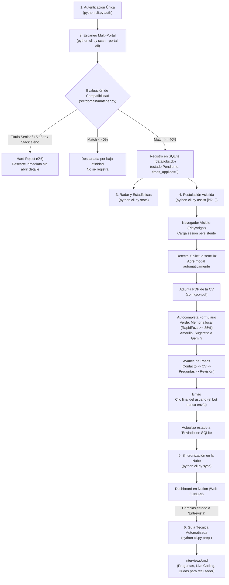

# Guía Definitiva de Comandos y Flujo de Trabajo — jobOS-bot

> **Manual integral de operaciones, flujo end-to-end y referencia de comandos para el copiloto de búsqueda laboral y postulación asistida.**

---

## 1. Flujo General del Sistema (Ciclo de Vida de una Vacante)

El siguiente diagrama ilustra cómo fluye una vacante desde su descubrimiento en los portales hasta la preparación de tu entrevista técnica:



---

## 2. Catálogo Completo de Comandos CLI (`cli.py`)

### 1. `python cli.py auth` — Gestor de Autenticación de Portales
Abre el navegador Chromium en modo visible utilizando tu perfil persistente en disco (`data/browser_profile/`).

* **¿Para qué sirve?:** Permite que inicies sesión manualmente en tus cuentas (LinkedIn, GetOnBrd, Computrabajo, Elempleo, Indeed, Glassdoor) una sola vez. Guarda las cookies en `data/storage_state.json` para que el bot nunca vuelva a pedirte login ni bloquee tus postulaciones.
* **Uso:**
  ```bash
  python cli.py auth
  ```
* **Opciones:**
  * `--output <ruta>`: Ruta personalizada del JSON de cookies (por defecto: `data/storage_state.json`).
* **Regla de oro:** Inicia sesión en tus portales en la ventana del navegador. **No cierres la ventana manualmente antes de presionar ENTER** en la terminal para que Playwright pueda volcar el archivo JSON sin interrumpir la conexión.

---

### 2. `python cli.py scan` — Motor de Escaneo Multi-Portal
Escanea de forma secuencial en un solo hilo (*single-thread*) los portales de empleo configurados, respetando pausas humanas aleatorias (2.5s a 6.0s) para evitar bloqueos anti-bot.

* **¿Para qué sirve?:** Descubre ofertas de trabajo, extrae la información limpia, evalúa las reglas de descarte (*Hard Rejects*) y el puntaje de afinidad (`Match %`), y registra las compatibles en SQLite como `Pendiente`. Si una oferta ya existía (republicada, en otro portal o con un cargo casi igual de la misma empresa), reutiliza la fila sin duplicarla. Las ofertas presenciales fuera de Barranquilla y las que piden más años de experiencia de los configurados se descartan.
* **Ejemplos de ejecución:**
  ```bash
  # Escanear todos los portales habilitados (por defecto 10 vacantes por portal en segundo plano)
  python cli.py scan --portal all

  # Escanear portales específicos
  python cli.py scan --portal linkedin,getonbrd

  # Limitar el escaneo a 5 vacantes por portal
  python cli.py scan --portal getonbrd --limit 5

  # Ver la ventana del navegador mientras escanea (ideal para verificar en vivo)
  python cli.py scan --portal getonbrd --limit 3 --no-headless
  ```
* **Opciones:**
  * `--portal`: Portales a incluir: `linkedin`, `getonbrd`, `computrabajo`, `elempleo`, `glassdoor`, `indeed` o `all` (separados por coma).
  * `--limit`: Límite máximo de ofertas a inspeccionar por portal (default: 10).
  * `--headless / --no-headless`: Modo invisible (headless) o visible en tu pantalla (default: `--headless`).

---

### 3. `python cli.py assist` — Copiloto de Postulación en Lote
Abre la vacante en el navegador con tu sesión persistente, detecta si tiene botón de *"Solicitud sencilla / Easy Apply / Postularme"*, autocompleta el formulario paso a paso y adjunta tu CV en PDF. Se detiene antes de enviar; solo marca `Enviado` si confirmas en la terminal que enviaste la postulación.

* **Modos de uso:**

  #### A. Por ID específico (una o varias vacantes en una sola línea)
  ```bash
  # Asistir la vacante #4
  python cli.py assist 4

  # Encolar y postular a múltiples vacantes en orden secuencial
  python cli.py assist 1 3 4 8
  python cli.py assist 1,3,4,8
  ```

  #### B. Cola de todas las pendientes o por afinidad (`--all`, `--min-score`, `--top`)
  ```bash
  # Encolar todas las vacantes pendientes
  python cli.py assist --all

  # Solo vacantes con afinidad alta (ej. Match >= 70%)
  python cli.py assist --all --min-score 70

  # Las mejores 5 vacantes pendientes con Match >= 70%
  python cli.py assist --min-score 70 --top 5
  ```
  En todos los casos el bot llena el formulario y **se detiene antes de enviar**: tú revisas y haces el clic final. Después confirmas en la terminal si se envió (por defecto *no*) y decides qué respuestas sugeridas por la IA se guardan en memoria.

  #### C. Modo Interactivo (sin argumentos)
  ```bash
  python cli.py assist
  ```
  Imprime una tabla Rich con las vacantes en estado `Pendiente` ordenadas por afinidad y te pregunta qué IDs deseas procesar.

---

### 4. `python cli.py autopilot` — Escaneo y Sincronización Desatendidos
Ejecuta sin intervención las fases que no postulan:
1. **Escaneo:** Busca ofertas recientes en todos los portales configurados.
2. **Evaluación:** Filtra descartes duros y calcula el puntaje de afinidad; las compatibles quedan en `Pendiente`.
3. **Sincronización:** Actualiza Notion y marca seguimientos tras 7 días.

**Nunca postula.** Para postular usa `python cli.py assist`, que se detiene antes del envío.

* **Ejemplos de uso:**
  ```bash
  python cli.py autopilot
  python cli.py autopilot --headless
  python cli.py autopilot --portal linkedin,getonbrd --limit 20
  ```

---

### 5. `python cli.py stats` — Radar de Mercado y Pipeline
Genera dos paneles analíticos con la información real almacenada en SQLite:

1. **Pipeline de Postulaciones:** Total de vacantes por estado (`Pendiente`, `Enviado`, `Requiere Seguimiento`, `Entrevista Programada`, etc.) y contador de re-postulaciones históricas.
2. **Radar de Tecnologías:** Ranking de los lenguajes, frameworks y bases de datos más solicitados en las ofertas reales, contrastados con tu porcentaje de cobertura personal.

* **Uso:**
  ```bash
  python cli.py stats
  ```

---

### 6. `python cli.py tailor <job_id>` — Optimización Quirúrgica de CV (Gemini)
Compara la descripción de la vacante seleccionada contra tu plantilla base en Markdown ([`config/cv_base.md`](../config/cv_base.md)).

* **¿Para qué sirve?:** Identifica la **Brecha ATS** (conceptos clave que pide la oferta y que no están explícitos en tu CV) y redacta de 2 a 3 viñetas (*bullets*) listas para copiar en tu perfil o carta de presentación, adaptadas a esa empresa sin inventar experiencia falsa.
* **Ejemplo:**
  ```bash
  python cli.py tailor 4
  ```

---

### 6b. `python cli.py cv` — CV en PDF Adaptado a Cada Vacante
Genera un PDF de tu hoja de vida por vacante en `cvs/<id>_<empresa>_<cargo>.pdf`, listo para que lo envíes tú. **No postula.**

* **¿Qué adapta?:**
  1. Ordena tus habilidades y categorías poniendo primero las que pide la oferta.
  2. Pone primero los proyectos que usan el stack de la oferta.
  3. Si hay `GEMINI_API_KEY`, reescribe el resumen profesional enfocado en la vacante. Si el texto menciona una tecnología o una cifra que no está en tu `config/cv_base.md`, se descarta y se usa tu resumen original.
* **Nunca agrega** tecnologías, años ni experiencia que no estén en tu CV base. Un PDF ya generado se reutiliza; usa `--force` para regenerarlo.
* **Ejemplos:**
  ```bash
  python cli.py cv 4
  python cli.py cv 4 7 9
  python cli.py cv --all --min-score 60
  python cli.py cv 4 --force
  ```
* **Requisito:** `config/cv_base.md` con tus datos reales (cópialo desde `config/cv_base.example.md`).

---

### 7. `python cli.py prep <job_id>` — Generador de Guía de Entrevista Técnica
Genera un documento Markdown completo en `interviews/<empresa>.md` para preparar tu entrevista con éxito.

* **Contenido generado:**
  1. Resumen técnico del cargo y mapa de temas críticos.
  2. 5 preguntas técnicas nivel Junior/Mid con respuestas guía fundamentadas en tu stack real.
  3. Reto de Live Coding con enunciado y solución comentada en código.
  4. 3 preguntas inteligentes de ingeniería para hacerle al entrevistador.
* **Ejemplo:**
  ```bash
  python cli.py prep 4
  ```

---

### 8. `python cli.py sync` — Sincronizador con Notion y Detección de Follow-ups
Mantiene tu base de datos local SQLite sincronizada con tu dashboard privado de Notion.

* **¿Qué ejecuta?:**
  * **Push:** Sube vacantes nuevas detectadas por el escáner a Notion con tags de colores, Match %, salario y enlace directo.
  * **Pull:** Si desde la app móvil de Notion cambiaste una vacante a *"Entrevista Programada"*, el bot lo detecta y genera automáticamente la guía técnica con `prep`.
  * **Follow-ups:** Si una postulación lleva más de 7 días sin respuesta de la empresa, la cambia a estado *"Requiere Seguimiento"*.
  * **Bootstrap:** Si descargas el proyecto en otro computador sin base de datos, reconstruye tu SQLite automáticamente desde Notion.
* **Ejemplo:**
  ```bash
  python cli.py sync
  ```

---

### 9. `python cli.py export` — Exportación de Datos
Vuelca los registros de SQLite a formatos estándar para análisis en hojas de cálculo o respaldo.

* **Ejemplos:**
  ```bash
  # Exportar a CSV (abre directamente en Excel / Google Sheets)
  python cli.py export --format csv

  # Exportar a JSON
  python cli.py export --format json

  # Exportar únicamente las vacantes enviadas
  python cli.py export --format csv --status "Enviado" --output exports/mis_postulaciones.csv
  ```

---

## 3. Escaneo Diario Desatendido

Si deseas que el bot busque vacantes nuevas y sincronice Notion todos los días sin abrir una terminal (las postulaciones siempre las envías tú con `assist`):

### Opción A: Script Autopilot bajo demanda
Ejecuta el script unificado [`scripts/autopilot.sh`](../scripts/autopilot.sh) en cualquier momento:
```bash
./scripts/autopilot.sh
```
O con opciones avanzadas (segundo plano silencioso y afinidad estricta):
```bash
./scripts/autopilot.sh --headless --limit 20
```

### Opción B: Cronjob Diario en Linux Debian (Recomendado)
Configura una tarea programada para que se ejecute de lunes a viernes en los horarios con más ofertas laborales nuevas (ej. 9:00 AM y 2:00 PM):

1. Abre el editor de tareas programadas del sistema:
   ```bash
   crontab -e
   ```
2. Agrega la siguiente línea al final del archivo:
   ```cron
   0 9,14 * * 1-5 /ruta/a/jobOS-bot/scripts/autopilot.sh --headless >> /ruta/a/jobOS-bot/data/autopilot.log 2>&1
   ```
3. Guarda y sal. El bot escaneará en segundo plano y registrará el progreso en `data/autopilot.log`. Revisa las vacantes nuevas con `python cli.py assist`.

---

## 4. Matriz de Estados de una Aplicación (`ApplicationStatus`)

Toda vacante transita por los siguientes estados dentro de SQLite y Notion:

| Estado | Significado | ¿Permite Re-postulación? |
| :--- | :--- | :---: |
| **`Pendiente`** | Vacante escaneada con Match $\ge 40\%$, pendiente por asistir. | Sí |
| **`Enviado`** | Formulario completado y enviado exitosamente. | Sí (tras 3 días de cooldown o en otro portal) |
| **`Requiere Seguimiento`** | Postulación enviada hace más de 7 días sin respuesta de la empresa. | Sí |
| **`Entrevista Programada`** | La empresa te contactó y estás en proceso de entrevistas. | **No (Congelado)** |
| **`Oferta Recibida`** | Propuesta formal recibida. | **No (Congelado)** |
| **`Rechazado`** | Proceso concluido por decisión de la empresa. | **No (Congelado)** |
| **`Descartado`** | Descartado manualmente por ti. | **No (Congelado)** |

---

## 5. Servidor MCP (`Model Context Protocol`)

`jobOS-bot` incluye un servidor nativo MCP via `stdio` que permite interactuar con tu pipeline mediante lenguaje natural desde Claude Desktop, Antigravity o Cursor.

* **Iniciar el servidor directamente:**
  ```bash
  python -m src.adapters.mcp.server
  ```
* **Herramientas disponibles para el agente:**
  1. `get_pipeline_overview`: Resumen global de postulaciones por estado.
  2. `search_applications`: Búsqueda de vacantes por empresa, cargo o tecnología.
  3. `get_market_stack_radar`: Estadísticas de las tecnologías más demandadas.
  4. `prepare_job_application_kit`: Dispara CV Tailor y Guía de Entrevista en un solo llamado.
  5. `sync_pipeline_with_notion`: Sincronización bajo demanda con Notion.

---

## 6. Preguntas Frecuentes y Solución de Problemas (FAQ)

### ¿Por qué `python cli.py auth` me dio error de `TargetClosedError`?
Ocurre cuando cierras la ventana del navegador con el mouse antes de presionar `ENTER` en la terminal. El navegador debe permanecer abierto mientras el bot ejecuta `storage_state()` para volcar las cookies a disco. En las últimas versiones, el sistema captura este evento y conserva las cookies directamente en `data/browser_profile/`.

### ¿Por qué Gemini mostró un aviso de `503 UNAVAILABLE`?
Los servidores gratuitos de Google AI Studio experimentan picos de saturación esporádicos. El cliente de IA cuenta con una lista de modelos de respaldo (`gemini-3.8-flash` $\rightarrow$ `gemini-2.0-flash` $\rightarrow$ `gemini-1.5-flash`) y degradación elegante a valores por defecto seguros para que tu postulación nunca se detenga.

### ¿Dónde configuro mis datos personales y CV?
- **Perfil ATS:** Edita [`config/profile.yaml`](../config/profile.yaml) (nombre, teléfono, ciudad, salario, años de experiencia).
- **Filtros de Búsqueda:** Edita [`config/filters.yaml`](../config/filters.yaml) (tecnologías core, whitelists, títulos buscados).
- **CV en PDF:** Coloca tu archivo en `config/cv.pdf` para que el bot lo adjunte automáticamente (los `*.pdf` están en `.gitignore`).

