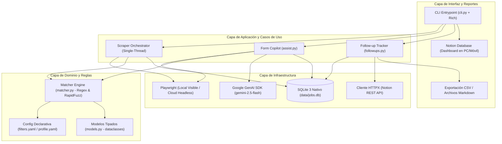

# 00. Visión General, Stack Tecnológico y Límites de Alcance

Este documento establece los cimientos arquitectónicos de `jobOS-bot`, justificando cada decisión técnica a partir de las métricas reales del problema y definiendo los límites para evitar sobre-ingeniería (*over-engineering*).

---

## 1. Diagnóstico de Realidad y Cuellos de Botella

Un candidato activo postula a entre **10 y 50 vacantes por semana** (~500 a 2,500 al año). En esa escala de volumen:

| Operación | Tiempo Promedio | Naturaleza del Cuello de Botella |
| :--- | :--- | :--- |
| Cargar una página de empleo en Playwright | `2,000 ms – 4,000 ms` | Red / Renderizado DOM + Pausas humanas |
| Llamar a la API de Notion o Gemini 2.5 Flash | `400 ms – 2,000 ms` | Latencia HTTP externa |
| Filtrar 100 vacantes con expresiones regulares en Python | `< 1 ms` | CPU local (despreciable) |
| Comparar una pregunta contra 300 respuestas con `RapidFuzz` | `< 0.5 ms` | CPU local con motor C++ (despreciable) |
| Exportar 2,000 filas de SQLite a CSV | `< 2 ms` | I/O de disco local (despreciable) |

### Los 3 Riesgos Reales del Sistema
El riesgo técnico del proyecto **nunca es la velocidad de CPU procesando texto**. Los riesgos reales son:
1. **Bloqueos anti-bot (Cloudflare, LinkedIn Authwall, Glassdoor):** Provocados por abrir múltiples pestañas en paralelo o navegar sin cookies de sesión válidas.
2. **Selectores DOM rotos:** Cuando un portal actualiza sus clases CSS y rompe el scraper completo si el código está acoplado.
3. **Exposición accidental de datos privados:** Al compartir el repositorio como proyecto de portafolio en GitHub.

---

## 2. Stack Tecnológico Definitivo (100% Python)

Se eligió una arquitectura **100% Python 3.11+** apoyada en librerías con motores compilados en C/C++ bajo el capó, logrando máxima velocidad de desarrollo y un diseño limpio para portafolio:

### Justificación de Librerías Clave
* **`playwright`:** Permite alternar entre modo interactivo con ventana visible (`headless=False`) en Windows 11 y modo desatendido (`headless=True`) en Docker / GitHub Actions.
* **`sqlite3` (Librería estándar):** Base de datos ACID en un único archivo (`data/jobs.db`). Fácil de respaldar y de almacenar en el caché de GitHub Actions sin pagar servidores de bases de datos.
* **`rapidfuzz`:** Implementación en C++ de algoritmos de distancia de edición (Levenshtein / Token Set Ratio) para emparejar preguntas de formularios al instante.
* **`google-genai` (`gemini-2.5-flash`):** Modelo rápido y con capa gratuita generosa para responder preguntas inéditas, adaptar el CV y generar guías de entrevista.
* **`rich`:** Formatea tablas, paneles y barras de progreso en la terminal.
* **`pytest`:** Garantiza que los motores de filtrado, deduplicación y matching estén verificados con pruebas unitarias deterministas.

---

## 3. Reglas Anti-Overengineering (Qué NUNCA Construir)

1. **Cero UI Web o Desktop propia (React / Electron / Tauri):** Tu interfaz gráfica en celular y PC ya es **Notion**, y tu consola de mando en local es la terminal con `Rich`.
2. **Cero ORMs pesados (SQLAlchemy / Tortoise / Prisma):** 3 tablas relacionales se consultan con SQL parametrizado puro en `src/db.py`, evitando capas de abstracción innecesarias.
3. **Cero Multithreading en Scraping:** Abrir 5 hilos contra LinkedIn o Computrabajo no acelera el proceso; solo bloquea tu IP. Toda extracción es **secuencial (*single-thread*)**.
4. **Cero Costos Mensuales (\$0.00/mes):** Prohibido depender de VPS pagos, bases de datos cloud de pago o proxies comerciales.

