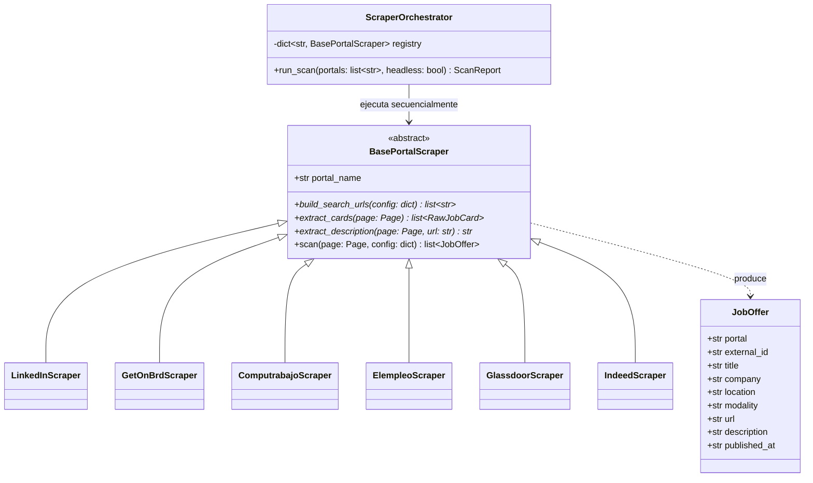
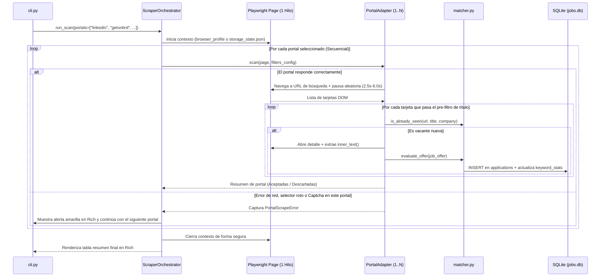

# 01. Motor de Scraping Multi-Portal Secuencial

Este documento detalla cómo `jobOS-bot` extrae vacantes de múltiples portales de empleo manteniendo **ejecución en un único hilo (*single-thread*)**, alta tolerancia a fallos y bajo riesgo de detección anti-bot.

---

## 1. Patrón de Diseño: Strategy / Adapter (`BasePortalScraper`)

Cada portal de empleo tiene una estructura HTML, paginación y URL de búsqueda completamente distinta, pero el resto del sistema (`matcher.py`, `db.py`, `notion.py`, `ai.py`) solo debe trabajar con un objeto estándar: `JobOffer`.

Para desacoplar los portales del núcleo del sistema, aplicamos el **Patrón Adapter / Strategy**:

### Ventajas para Mantenimiento y Portafolio
* **Principio Abierto/Cerrado (SOLID):** Para agregar un séptimo portal en el futuro, basta con crear un nuevo archivo en `src/scrapers/` que herede de `BasePortalScraper`. No se modifica ni una sola línea de la base de datos ni del motor de filtrado.
* **Pre-filtrado en dos etapas (Ahorro de peticiones):**
  1. **Etapa 1 (Listado / Tarjetas):** El scraper lee los títulos y nombres de empresa de la lista de resultados y aplica de inmediato la *blacklist* de títulos (`Senior`, `.NET`, `PHP`, etc.) y de empresas. Si la tarjeta es descartada, **ni siquiera entra a cargar la página de detalle**.
  2. **Etapa 2 (Detalle):** Solo para las vacantes que superan el filtro de título, el navegador abre el detalle, extrae la descripción limpia (`inner_text()`) y calcula el match de tecnologías.

---

## 2. Clasificación de Portales por Tiers

El sistema organiza los portales en tres niveles según su relevancia para vacantes **Junior / Entry-Level (React, Node.js, NestJS, PostgreSQL)** en **Remoto o Barranquilla/Colombia**:

| Tier | Portales | Enfoque Principal | Particularidades Técnicas |
| :--- | :--- | :--- | :--- |
| **Tier 1: Núcleo Tech & Remoto** | **LinkedIn Jobs**, **GetOnBrd** | Vacantes de ingeniería de software en startups y empresas tech en Latam/Remoto. | GetOnBrd tiene HTML semántico muy limpio; LinkedIn requiere pausas humanas y sesión persistente para ver descripciones completas. |
| **Tier 2: Mercado Nacional (Colombia)** | **Computrabajo**, **Elempleo.com** | Empresas colombianas (Barranquilla, Bogotá remoto, Medellín remoto). | Abundan ofertas con títulos genéricos (*"Ingeniero de Sistemas"*, *"Desarrollador Web"*); el filtro sobre la descripción es clave aquí. |
| **Tier 3: Portales Globales** | **Glassdoor**, **Indeed Colombia** | Agregadores internacionales con presencia en Colombia y vacantes remotas. | Mayor presencia de protecciones Cloudflare; requieren reutilizar cookies (`storage_state.json`) y tolerancia a fallos. |

---

## 3. Ejecución Single-Thread y Aislamiento de Fallos (*Graceful Degradation*)

Cuando ejecutas `python cli.py scan --portal all`, el `ScraperOrchestrator` realiza el siguiente ciclo en **un único hilo y una sola pestaña activa**:

### Mecanismos Anti-Bot Incorporados
1. **Un solo hilo secuencial:** Nunca hay dos peticiones simultáneas desde tu IP.
2. **Jitter humano (`human_delay`):** Entre cada clic o cambio de página se aplica un `time.sleep(random.uniform(2.5, 6.0))` junto con un scroll progresivo suave para disparar el *lazy-loading* del DOM como lo haría una persona.
3. **Cortocircuito por URL conocida:** Antes de entrar al detalle de una oferta, el scraper verifica en `< 0.5 ms` si esa URL o combinación `(empresa, título)` ya existe en SQLite. Si ya fue procesada en una corrida anterior, la salta sin hacer clic.

