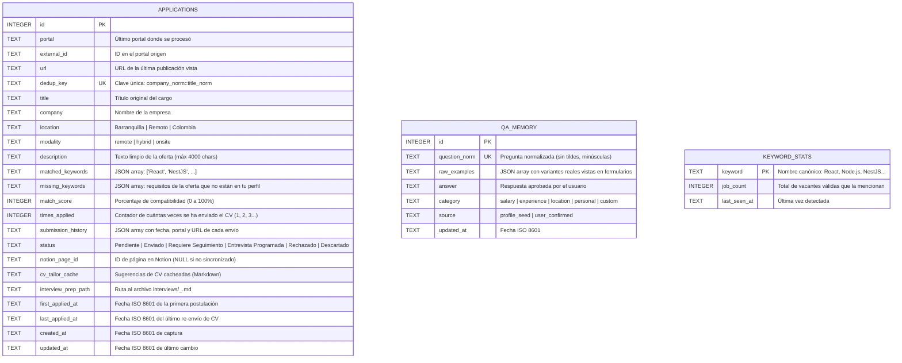
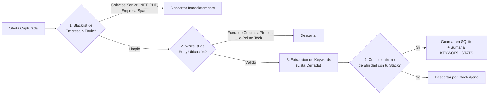

# 02. Modelo de Datos, Filtrado Declarativo y Deduplicación

Este documento describe el diseño de la base de datos local en **SQLite**, el funcionamiento del motor de reglas declarativas (`src/matcher.py`) y la estrategia para evitar vacantes duplicadas entre distintos portales.

---

## 1. Esquema Relacional en SQLite (`src/schema.sql`)

Toda la persistencia reside en `data/jobs.db`, gestionada mediante SQL parametrizado puro en `src/db.py` sin ORMs. Consta de **3 tablas principales**:



---

## 2. Registro Único y Contador de Re-Postulaciones (`dedup_key` + `times_applied`)

Es muy común que una empresa republica la misma vacante días después o la publique simultáneamente en **LinkedIn**, **GetOnBrd** y **Computrabajo**. La regla de negocio (detallada en [`docs/logica-negocio/02-ciclo-postulacion-y-repostulacion.md`](../logica-negocio/02-ciclo-postulacion-y-repostulacion.md)) establece que **el bot vuelve a postularse, pero mantiene un único registro en SQLite y Notion**:

1. **Clave de Identidad Semántica (`dedup_key`):**
   * Se normaliza el nombre de la empresa y el título del cargo: minúsculas, sin tildes, sin signos de puntuación y removiendo sufijos societarios (`s.a.s`, `inc`, `llc`, `ltda`).
   * Ejemplo: `"Desarrollador Full Stack Junior (React/Node)"` en `"TechCorp S.A.S."` genera:
     ```text
     techcorp::desarrollador full stack junior react node
     ```
2. **Upsert con Incremento de Contador (`ON CONFLICT(dedup_key) DO UPDATE`):**
   * Si la oferta se encuentra por primera vez y cumple el umbral de compatibilidad (`match_score >= 40%`), se inserta con `times_applied = 1`.
   * Si la oferta vuelve a aparecer (en otro portal o republicada tras los días de enfriamiento) y es elegible para re-postulación, el bot **vuelve a enviar la hoja de vida**, pero en SQLite ejecuta un `UPDATE` sobre la misma fila incrementando `times_applied = times_applied + 1`, actualizando `last_applied_at` y agregando la traza al JSON `submission_history`.

---

## 3. Pipeline de Filtrado Declarativo (`config/filters.yaml` + `src/matcher.py`)

Ninguna palabra clave está quemada en el código Python. Todo el criterio de evaluación se carga desde `config/filters.yaml` y pasa por 4 compuertas secuenciales en menos de `1 ms` por vacante:



### Reglas Configurables en `config/filters.yaml`
* **`title_blacklist` (Descarte inmediato):** `senior`, `sr.`, `lead`, `tech lead`, `staff`, `principal`, `architect`, `manager`, `director`, `+5 años`, `5+ years`, `.net`, `c#`, `php`, `laravel`, `wordpress`, `cobol`, `sap`, `abap`, `ruby on rails`, `ios`, `swift`, `android nativo`.
* **`company_blacklist`:** Lista de consultoras de spam, portales revendedores o empresas donde ya no deseas postular.
* **`title_whitelist`:** `junior`, `jr`, `entry level`, `trainee`, `associate`, `desarrollador`, `software engineer`, `full stack`, `fullstack`, `backend`, `frontend`, `web developer`, `ingeniero de desarrollo`.
* **`location_whitelist`:** `remoto`, `remote`, `barranquilla`, `atlántico`, `colombia`, `latam`.
* **`tech_vocabulary` (Diccionario cerrado para `stats` y `score`):**
  * **Core Stack (Alto peso):** `React`, `Node.js`, `NestJS`, `TypeScript`, `JavaScript`, `PostgreSQL`, `Next.js`, `Express`.
  * **Complementarias (Peso medio):** `SQL`, `Prisma`, `TypeORM`, `Docker`, `Git`, `REST API`, `GraphQL`, `Jest`, `Testing`, `AWS`, `Linux`, `CI/CD`, `Redis`, `Tailwind`.

---

## 4. Radar Estadístico de Mercado (`python cli.py stats`)

En lugar de usar algoritmos de TF-IDF abiertos (que llenan los reportes de palabras basura como *"importante empresa"*, *"salario emocional"* o *"trabajo bajo presión"*), el comando `stats` cruza las ofertas válidas únicamente contra `tech_vocabulary`.

El resultado se muestra en consola con `Rich` indicando el porcentaje exacto de aparición de cada tecnología en las ofertas reales a las que apuntas (ej. *"PostgreSQL aparece en el 74% de las vacantes Junior encontradas, Docker en el 58%, NestJS en el 41%"*), permitiéndote priorizar qué estudiar o qué destacar primero en tu CV.

