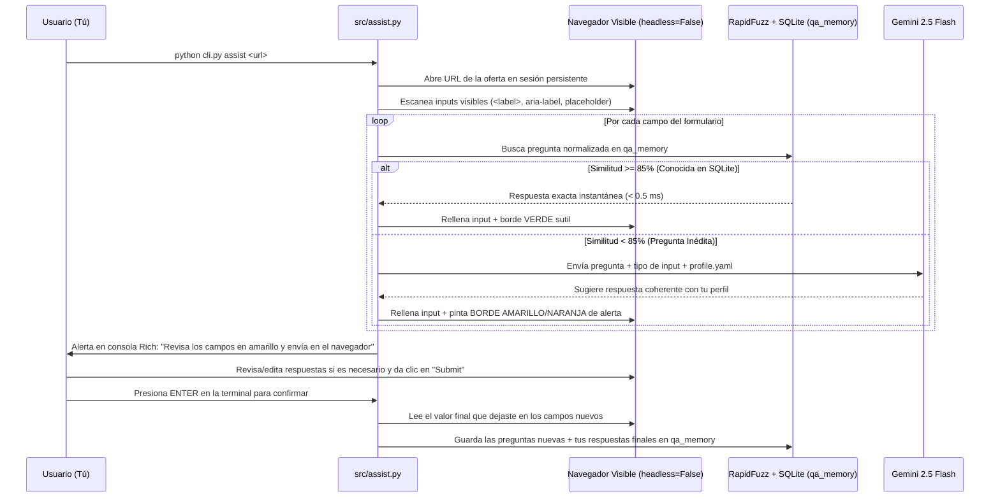

# 03. Copiloto de Autocompletado (`qa_memory`) e IA Quirúrgica

Este documento explica cómo `jobOS-bot` utiliza inteligencia artificial (`gemini-2.5-flash`) y similitud de cadenas (`RapidFuzz`) de forma quirúrgica para asistir en el llenado de formularios, optimizar tu CV y preparar entrevistas técnicas sin desperdiciar tokens ni arriesgar postulaciones.

---

## 1. Memoria de Autocompletado Asistido (`python cli.py assist <url>`)

Los formularios de postulación (Workday, Greenhouse, Lever, GetOnBrd, LinkedIn Easy Apply, formularios propios) repiten el 85% de las preguntas con pequeñas variaciones de redacción:
* *"¿Cuántos años de experiencia tienes con React?"*
* *"Años de experiencia trabajando con React.js"*
* *"Years of experience with React"*

Enviar todas las preguntas de cada formulario a un LLM es lento y costoso. Hacer clic automático en *"Enviar"* sin supervisión humana es peligroso (una expectativa salarial en dólares cuando el campo pedía pesos colombianos arruina tu postulación).

### Flujo *Human-in-the-Loop* con Memoria Local + Fallback a Gemini

### Semilla Inicial (`config/profile.yaml`)
Al inicializar la base de datos, `qa_memory` se pre-carga automáticamente con tus datos base definidos en `config/profile.yaml`:
* Nombre completo, correo, teléfono, ciudad (`Barranquilla, Colombia`), links a LinkedIn, GitHub y Portafolio.
* Años de experiencia por tecnología (`React`, `Node.js`, `NestJS`, `TypeScript`, `PostgreSQL`).
* Nivel de inglés, disponibilidad de inicio, modalidad preferida y expectativa salarial en COP y USD.

---

## 2. Optimización Quirúrgica de Hoja de Vida (`python cli.py tailor <job_id>`)

Cuando una vacante guardada en SQLite te interesa especialmente, ejecutas `python cli.py tailor <job_id>`:

1. **Revisión de Caché:** Verifica si `applications.cv_tailor_cache` ya tiene un análisis guardado para ese `job_id`. Si existe, lo imprime al instante sin gastar llamadas a la API.
2. **Construcción del Prompt Limpio:** Toma únicamente el texto limpio de `applications.description` (recortado a un máximo de 4,000 caracteres sin etiquetas HTML) y tu archivo local `config/cv_base.md`.
3. **Respuesta Estructurada en Consola (`Rich`):**
   * **Brecha de Keywords (ATS Gap):** Qué tecnologías o conceptos pide explícitamente esa vacante que no están mencionados con esas palabras exactas en tu `cv_base.md`.
   * **Bullets Re-enfocados (2 a 3 sugerencias):** Cómo redactar tus proyectos reales para resaltar las responsabilidades que busca esa empresa específica, con la regla estricta de **nunca inventar tecnologías ni experiencia falsa**.

---

## 3. Preparador de Entrevistas Técnicas (`python cli.py prep <job_id>`)

Cuando pasas a etapa de entrevista (detectado automáticamente al sincronizar con Notion o ejecutando `python cli.py prep <job_id>`):

1. Cruza los requisitos específicos de la vacante (`applications.description`) con tu stack principal (`React`, `Node.js`, `NestJS`, `TypeScript`, `PostgreSQL`).
2. Genera un documento de estudio completo en `interviews/<id>_<empresa>.md` que incluye:
   * **Resumen del Rol y Mapa de Temas Críticos:** Qué es lo más probable que te evalúen según la descripción.
   * **5 Preguntas Técnicas de Nivel Junior/Mid con Respuesta Guía:** Ejemplo: ciclo de vida e inyección de dependencias en `NestJS`, manejo de promesas/eventos en `Node.js`, prevención de re-renders innecesarios en `React`, o índices y joins en `PostgreSQL`.
   * **1 Reto Práctico de Live Coding:** Un ejercicio realista (enunciado + solución paso a paso en TypeScript) acorde a lo que pide la vacante.
   * **3 Preguntas para el Entrevistador:** Preguntas inteligentes sobre la arquitectura del equipo para cerrar la entrevista destacando interés técnico.

