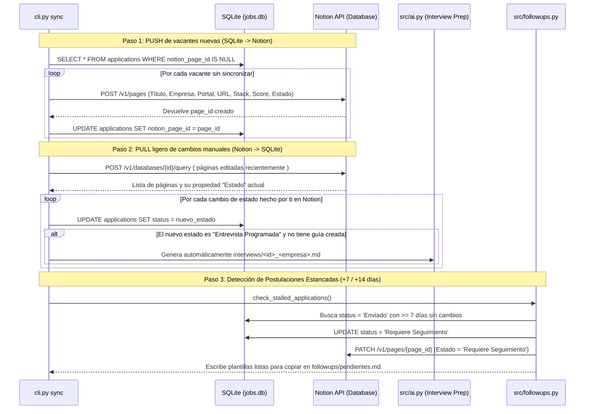

# 04. Sincronización con Notion y Seguimiento Automatizado (Follow-ups)

Este documento describe cómo `jobOS-bot` mantiene sincronizada tu base de datos local en SQLite con tu tablero visual en **Notion** (accesible desde tu PC o desde la app móvil cuando estás fuera de casa) y cómo automatiza el seguimiento de tus postulaciones.

---

## 1. Principio Arquitectónico: SQLite como Fuente de Verdad, Notion como Vista

En lugar de construir un frontend web propio o depender 100% de la latencia de la API de Notion para filtrar ofertas, el sistema aplica una arquitectura **Local-First con Sincronización Bajo Demanda (`python cli.py sync`)**:

* **SQLite (`data/jobs.db`)** almacena todo el historial, las descripciones completas, los cachés de IA y las métricas.
* **Notion** funciona como tu **CRM visual interactivo** (tablero Kanban / tabla en tu celular o navegador) donde ves las vacantes nuevas y cambias el estado con un toque (por ejemplo, cuando te llaman a entrevista o te responden un correo).

---

## 2. Protocolo de Sincronización en 3 Pasos (`python cli.py sync`)

Cada vez que se ejecuta `python cli.py sync` (manualmente en tu PC o automáticamente al final de un escaneo programado en GitHub Actions), ocurren tres operaciones secuenciales a través de `src/notion.py` (usando `httpx` directo contra la API REST v1 de Notion):

---

## 3. Propiedades de la Base de Datos en Notion

Para mantener el conector simple y rápido, tu tabla en Notion utiliza únicamente las siguientes columnas estándar:

| Propiedad en Notion | Tipo en Notion | Origen / Comportamiento |
| :--- | :--- | :--- |
| **Cargo** | `Title` | Título de la oferta (`applications.title`). |
| **Empresa** | `Rich Text` | Nombre de la empresa (`applications.company`). |
| **Portal** | `Select` | `LinkedIn`, `GetOnBrd`, `Computrabajo`, `Elempleo`, `Glassdoor`, `Indeed`. |
| **Estado** | `Select` | `Pendiente`, `Enviado`, `Requiere Seguimiento`, `Entrevista Programada`, `Rechazado`. |
| **Modalidad** | `Select` | `Remoto`, `Híbrido (Barranquilla)`, `Presencial (Barranquilla)`. |
| **Stack Detectado** | `Multi-select` | Etiquetas extraídas por el matcher (`React`, `NestJS`, `Node.js`, `PostgreSQL`, etc.). |
| **Match (%)** | `Number` | Porcentaje de compatibilidad calculado (`>= 40%` se postula aunque no cumpla el 100% de requisitos). |
| **Veces Postulado** | `Number` | Contador `times_applied` (`1`, `2`, `3`...) actualizado sobre la misma tarjeta cada vez que se re-postula. |
| **Link Oferta** | `URL` | Enlace directo para abrir la vacante desde el celular o PC (`applications.url`). |
| **Último Envío** | `Date` | Fecha ISO de la última vez que se envió la hoja de vida (`last_applied_at`). |

---

## 4. Motor de Seguimiento Automatizado (`src/followups.py`)

Muchas postulaciones quedan en silencio simplemente porque el reclutador recibió decenas de CVs. Hacer un seguimiento cortés a los **7 días** aumenta notablemente la tasa de respuesta, pero llevar la cuenta a mano es tedioso.

1. **Detección por SQL:**
   * Primer recordatorio: postulaciones en estado `Enviado` cuya fecha (`applied_at` o `updated_at`) cumple **`>= 7 días`**.
   * Segundo recordatorio (cierre): postulaciones que cumplen **`>= 14 días`** sin respuesta.
2. **Generación de Borradores (`followups/pendientes.md`):**
   * El módulo genera un archivo Markdown limpio con mensajes breves, profesionales y personalizados con el nombre de la empresa, el título exacto de la vacante y las tecnologías clave que manejas, listos para copiar y pegar en LinkedIn o correo electrónico en 10 segundos.

