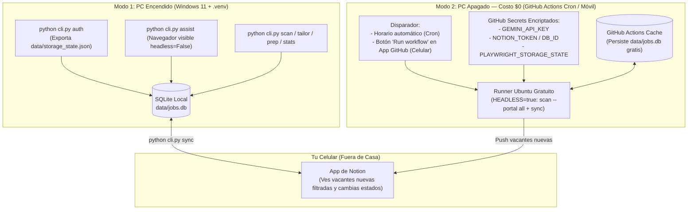

# 05. Despliegue Híbrido (\$0/mes), Docker y Privacidad

Este documento explica cómo `jobOS-bot` puede ejecutarse tanto **en vivo en tu PC con Windows 11** como **en segundo plano con tu PC completamente apagado** sin pagar servidores (**\$0.00/mes**), manteniendo tus datos privados aislados del código público de tu portafolio.

---

## 1. Arquitectura de Ejecución Dual (Local vs. Cloud \$0)

El sistema separa las tareas que requieren tus ojos (enviar un formulario con `assist`) de las tareas pesadas y repetitivas que pueden ocurrir mientras estás fuera de casa con el PC apagado (`scan` + `sync`).



### ¿Cómo funciona el Modo Cloud con el PC apagado sin pagar nada?
1. **Minutos gratuitos de GitHub Actions:** En repositorios públicos (como tu proyecto de portafolio), GitHub Actions ofrece ejecución **100% gratuita e ilimitada** en máquinas virtuales Linux (y 2,000 minutos/mes gratis en repositorios privados).
2. **Inyección segura de sesión (`PLAYWRIGHT_STORAGE_STATE`):**
   * En tu PC ejecutas `python cli.py auth` una vez para iniciar sesión en tus portales. Eso guarda tus cookies en `data/storage_state.json`.
   * Copias ese contenido dentro de los **Secrets encriptados de tu repositorio en GitHub** (nadie en internet puede leer los *Secrets*, ni siquiera en un repositorio público).
   * Cuando GitHub Actions despierta a la hora programada (ej. 8:00 AM, 2:00 PM y 8:00 PM) o cuando lo activas desde tu celular, reconstruye `storage_state.json` en la memoria temporal del contenedor, escanea con `HEADLESS=true` y destruye la máquina al terminar.
3. **Persistencia de SQLite sin servidor (`actions/cache`):**
   * Antes de iniciar el escaneo, el workflow restaura tu archivo `data/jobs.db` desde el caché privado de GitHub Actions.
   * Al terminar de escanear y sincronizar con Notion, guarda el `data/jobs.db` actualizado de vuelta en el caché.
   * Cuando regresas a casa y enciendes tu PC, `python cli.py sync` sincroniza cualquier cambio que hayas hecho desde tu celular en Notion.

---

## 2. Contenedorización con Docker (`Dockerfile` + `docker-compose.yml`)

Incluir soporte nativo para Docker cumple un doble propósito: permite ejecutar el bot en cualquier entorno aislado con un solo comando y **demuestra en tu portafolio dominio de contenedores con automatización de navegadores**.

* **Imagen Base Oficial:** `mcr.microsoft.com/playwright/python:v1.50.0-noble` (incluye Python + binarios de Chromium y dependencias del sistema preinstaladas).
* **Volúmenes Persistentes en `docker-compose.yml`:**
  * `./data:/app/data` (para conservar `jobs.db` y las sesiones del navegador en disco).
  * `./config:/app/config:ro` (para leer tus filtros y perfil en modo solo lectura).
  * `./interviews:/app/interviews` y `./followups:/app/followups` (para que los documentos generados aparezcan en tu carpeta local).

```powershell
# Ejecutar escaneo completo dentro de Docker
docker compose run --rm jobos scan --portal all

# Ejecutar la suite de pruebas unitarias dentro de Docker
docker compose run --rm jobos pytest
```

---

## 3. Modelo de Privacidad y Seguridad (Portafolio Público vs. Datos Privados)

Como el repositorio será visible en tu portafolio profesional, la separación entre **código de ingeniería (público)** y **datos personales (privados)** es absoluta:

| Archivo / Carpeta | Estado en Git | Propósito |
| :--- | :--- | :--- |
| `src/`, `cli.py`, `tests/`, `docs/` | **Público (Versionado)** | Código fuente tipado, tests unitarios y documentación de arquitectura para reclutadores. |
| `Dockerfile`, `docker-compose.yml`, `.github/workflows/` | **Público (Versionado)** | Infraestructura como código, CI con `pytest` y automatización programada. |
| `config/filters.yaml` | **Público (Versionado)** | Reglas de filtrado técnico (Junior, Remoto, Barranquilla, React/Node/NestJS/PostgreSQL). |
| `config/profile.example.yaml`, `config/cv_base.example.md`, `.env.example` | **Público (Versionado)** | Plantillas con datos ficticios para que cualquiera que clone tu repo entienda cómo funciona. |
| `.env` | **Privado (Bloqueado en `.gitignore`)** | Tus llaves reales (`GEMINI_API_KEY`, `NOTION_TOKEN`, `NOTION_DATABASE_ID`). |
| `data/` (`jobs.db`, `browser_profile/`, `storage_state.json`) | **Privado (Bloqueado en `.gitignore`)** | Tus cookies de sesión, historial de postulaciones y respuestas guardadas. |
| `config/profile.yaml`, `config/cv_base.md` | **Privado (Bloqueado en `.gitignore`)** | Tu teléfono, correo, expectativa salarial real y tu hoja de vida personal. |
| `interviews/`, `followups/` | **Privado (Bloqueado en `.gitignore`)** |Tus guías de entrevistas y borradores de mensajes para empresas reales. |

