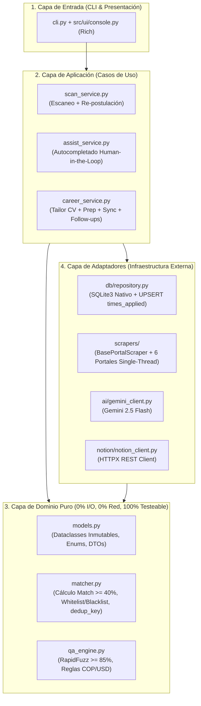

# 06. Tipo de Arquitectura, Árbol de Módulos, Clean Code y Plan de Pruebas

Este documento define el **tipo exacto de arquitectura de software**, el **árbol completo de carpetas y módulos**, cómo se aplican los principios **DRY, KISS, YAGNI y Clean Code (con mentalidad de tipado estricto TypeScript llevada a Python 3.11+)** y el **plan paso a paso de implementación y pruebas**.

---

## 1. ¿Qué Tipo de Arquitectura Vamos a Usar?

Utilizaremos **Lightweight Clean / Hexagonal Architecture (Ports & Adapters)** gobernada estrictamente por **KISS, DRY y YAGNI**.

### ¿Por qué esta arquitectura y cómo respeta KISS/YAGNI?
En proyectos de portafolio es común ver dos extremos malos: un script espagueti de 1,500 líneas en un solo archivo, o una sobre-ingeniería empresarial con 40 carpetas de interfaces vacías. Nuestra **Arquitectura Hexagonal Ligera** divide el sistema en **4 capas claras con regla de dependencia hacia adentro**, sin un solo archivo de relleno (*boilerplate*):



### Regla de Dependencia
1. **`src/domain/` no importa nada de `playwright`, `sqlite3`, `httpx` ni `google-genai`.** Solo recibe tipos puros y devuelve decisiones de negocio. Esto permite probar el 100% de la lógica de negocio con `pytest` en milisegundos.
2. **Los Adaptadores (`src/adapters/`) se encargan del mundo real** (DOM de los 6 portales, consultas SQL, llamadas HTTP a Notion y Gemini) y convierten todo a los modelos de `src/domain/models.py`.

---

## 2. Árbol Completo de Organización de Carpetas y Módulos

```text
jobOS-bot/
├── cli.py                                  # Punto de entrada único CLI (parseo de comandos)
├── requirements.txt                        # Dependencias fijadas (playwright, rapidfuzz, rich, etc.)
├── pyproject.toml                          # Configuración de pytest, mypy y formato
├── Dockerfile                              # Imagen oficial Playwright Python para ejecución aislada
├── docker-compose.yml                      # Orquestación local con volúmenes persistentes
├── .env.example                            # Plantilla pública de variables de entorno
├── .gitignore                              # Bloqueo estricto de datos privados y sesiones
│
├── .github/
│   └── workflows/
│       ├── ci.yml                          # Ejecuta pytest + typecheck en cada push (Badge Portafolio)
│       └── scheduled_scan.yml              # Corre el bot gratis (PC apagado) con Cron + Cache + Secrets
│
├── config/
│   ├── filters.yaml                        # Whitelists, blacklists, pesos de Match % y cooldown
│   ├── profile.example.yaml                # Plantilla pública de datos del candidato
│   └── cv_base.example.md                  # Plantilla pública de Hoja de Vida en Markdown
│
├── docs/
│   ├── arquitectura/                       # 7 documentos de diseño técnico y diagramas
│   └── logica-negocio/                     # 5 documentos de reglas de negocio y scoring
│
├── src/
│   ├── __init__.py
│   ├── config_loader.py                    # Carga y valida YAML/.env en dataclasses tipados (DRY)
│   │
│   ├── domain/                             # NÚCLEO PURO (Sin I/O ni red)
│   │   ├── __init__.py
│   │   ├── models.py                       # Enums, JobOffer, MatchResult, ApplicationRecord, QAMatch
│   │   ├── text_normalizer.py              # Normalización de texto, URLs canónicas y dedup_key (DRY)
│   │   ├── matcher.py                      # Evaluación Hard Rejects y cálculo de Match % (>= 40%)
│   │   └── qa_engine.py                    # Similitud RapidFuzz (>= 85%) y reglas de moneda/experiencia
│   │
│   ├── adapters/                           # INFRAESTRUCTURA (Puertos externos)
│   │   ├── __init__.py
│   │   ├── db/
│   │   │   ├── schema.sql                  # DDL de las 3 tablas (applications, qa_memory, keyword_stats)
│   │   │   └── repository.py               # CRUD SQL parametrizado + UPSERT de times_applied
│   │   │
│   │   ├── scrapers/
│   │   │   ├── base.py                     # Clase abstracta BasePortalScraper (Template Method + pausas)
│   │   │   ├── browser.py                  # Gestión Dual de Playwright (browser_profile vs storage_state)
│   │   │   ├── orchestrator.py             # Ejecución secuencial single-thread con graceful degradation
│   │   │   ├── linkedin.py                 # Adaptador LinkedIn Jobs
│   │   │   ├── getonbrd.py                 # Adaptador GetOnBrd
│   │   │   ├── computrabajo.py             # Adaptador Computrabajo Colombia
│   │   │   ├── elempleo.py                 # Adaptador Elempleo.com
│   │   │   ├── glassdoor.py                # Adaptador Glassdoor
│   │   │   └── indeed.py                   # Adaptador Indeed Colombia
│   │   │
│   │   ├── ai/
│   │   │   └── gemini_client.py            # Prompts estructurados para QA fallback, CV tailor e Interview prep
│   │   │
│   │   ├── notion/
│   │   │   └── notion_client.py            # Cliente HTTPX para Push de vacantes, Pull de estados y Bootstrap Multi-PC
│   │   │
│   │   └── mcp/
│   │       └── server.py                   # Servidor MCP nativo (stdio) exponiendo 5 tools para agentes de IA
│   │
│   ├── services/                           # CASOS DE USO (Coordinación)
│   │   ├── __init__.py
│   │   ├── scan_service.py                 # Flujo: Escanear -> Evaluar % -> Postular/Re-postular -> Guardar
│   │   ├── assist_service.py               # Flujo: Leer inputs -> Rellenar (SQLite/Gemini) -> Pausar antes de Submit
│   │   └── career_service.py               # Flujo: Stats, Tailor CV, Prep Entrevista, Sync Notion y Follow-ups
│   │
│   └── ui/                                 # PRESENTACIÓN EN CONSOLA
│       └── console.py                      # Tablas Rich, barras de progreso y paneles de resultados
│
└── tests/                                  # SUITE F.I.R.S.T. (Pytest - Cero red, 100% determinista)
    ├── test_text_normalizer.py             # Verifica generación de dedup_key y limpieza de URLs
    ├── test_matcher.py                     # Verifica cálculo de Match %, Hard Rejects y umbral >= 40%
    ├── test_qa_engine.py                   # Verifica matching >= 85% y detección de moneda COP vs USD
    └── test_repository.py                  # Verifica en SQLite `:memory:` que re-postular incrementa times_applied sin duplicar filas
```

---

## 3. Reglas de Ingeniería: Clean Code + Mentalidad TypeScript + DRY / KISS / YAGNI

Todo el código que escribiremos aplica de forma estricta las reglas de Clean Code y tipado fuerte:

### A. Mentalidad TypeScript aplicada a Python 3.11+
1. **Prohibido `Any` y diccionarios sueltos (`dict[str, Any]`) entre capas:**
   * En lugar de pasar diccionarios mágicos que fallan en tiempo de ejecución con `KeyError`, definimos contratos inmutables con `@dataclass(frozen=True, slots=True)` y `Literal` / `StrEnum` (equivalente a las `interface` y *Discriminated Unions* de TypeScript).
2. **Modelado de Estados Imposibles:**
   * `PortalName = Literal["linkedin", "getonbrd", "computrabajo", "elempleo", "glassdoor", "indeed"]`
   * `ApplicationStatus` como `StrEnum` cerrado.
3. **Retorno Explícito de Tipos:**
   * Toda función declara los tipos de todos sus parámetros y su retorno (`def evaluate_offer(offer: JobOffer, rules: FilterConfig) -> MatchEvaluation:`).

### B. Reglas de Clean Code y Diseño de Funciones
1. **Código 100% en Inglés, Nombres con Intención Reveladora:**
   * Prohibido usar nombres genéricos como `data`, `info`, `manager`, `process`, `handle`, `temp`.
   * Clases con sustantivos (`ApplicationRepository`, `OfferMatcher`); funciones con verbos precisos (`calculate_match_percentage`, `record_submission_attempt`).
2. **Funciones Pequeñas (< 20 líneas) y de Responsabilidad Única (SRP):**
   * Un solo nivel de abstracción por función.
   * **Guard Clauses (Return Early):** Validar precondiciones al inicio y retornar temprano para evitar bloques `if/else` anidados.
3. **0 a 2 Argumentos Ideales (Máximo 3):**
   * Prohibido pasar listas de 6 parámetros primitivos o *boolean flags* (`def scan(url, headless, retry, portal, save)` ❌). Se agrupa en un objeto de configuración tipado (`ScanRequest`).
4. **Separación Command-Query (CQS):**
   * Una función que consulta datos (`find_application_by_dedup_key`) nunca modifica estado en silencio; una función que muta estado (`increment_times_applied`) tiene un nombre que lo deja claro.
5. **Higiene de Comentarios (`antislop-code`):**
   * Cero separadores decorativos (`# =======`), cero comentarios que repiten lo que dice el nombre de la función, cero emojis en comentarios de código. Solo se comenta el *porqué* de una regla de negocio o restricción técnica.

### C. Aplicación Concreta de DRY, KISS y YAGNI
* **DRY:** La lógica de esperar pausas humanas, extraer tarjetas y manejar errores de un portal se escribe **una sola vez** en `BasePortalScraper.scan()` (patrón *Template Method*). Cada portal hijo solo implementa los selectores CSS específicos.
* **KISS:** Para probar la base de datos en `tests/test_repository.py`, usamos `sqlite3.connect(":memory:")` nativo. Cero mocks complejos de bases de datos.
* **YAGNI:** No creamos clases abstractas para el repositorio ni para el cliente de Notion porque solo tenemos una base de datos (`SQLite`) y un dashboard (`Notion`). Solo `BasePortalScraper` es abstracta porque tiene 6 implementaciones reales.

---

## 4. Plan de Implementación y Pruebas Paso a Paso (Cómo Crear e Ir Probando)

Construiremos el proyecto en **6 bloques incrementales**. **Regla estricta:** No se pasa al siguiente bloque hasta haber ejecutado el comando de prueba del bloque actual y verificado que pasa al 100%.

### Bloque 1: Cimientos, Modelos Tipados y Normalizador (`domain`)
* **Qué se crea:**
  * `.gitignore`, `.env.example`, `requirements.txt`, `pyproject.toml`.
  * `src/domain/models.py` (Todos los `dataclass` y `StrEnum`).
  * `src/domain/text_normalizer.py` (Limpieza de texto, `canonical_url` y generación de `dedup_key` `empresa::titulo`).
* **Cómo se prueba inmediatamente:**
  * Se crea `tests/test_text_normalizer.py` y se ejecuta:
    ```powershell
    pytest tests/test_text_normalizer.py -v
    ```
  * Verifica que ofertas con tildes, mayúsculas, `"S.A.S."` o URLs con `?utm_source=` produzcan exactamente el mismo `dedup_key`.

### Bloque 2: Motor de Scoring (`Match >= 40%`) y Configuración Declarativa
* **Qué se crea:**
  * `config/filters.yaml` y `src/config_loader.py`.
  * `src/domain/matcher.py` (Evaluación de *Hard Rejects*, conteo ponderado de tecnologías y regla de postular si `match_score >= 40%` aunque falten requisitos).
* **Cómo se prueba inmediatamente:**
  * Se crea `tests/test_matcher.py` y se ejecuta:
    ```powershell
    pytest tests/test_matcher.py -v
    ```
  * Casos probados:
    1. Oferta con título `"Senior .NET Developer"` -> Rechazada (`0%`, *Hard Reject*).
    2. Oferta que pide `React, Node.js, TypeScript, AWS, Kubernetes, Kafka` (cumples la mitad del stack pero tienes el Core) -> **Aceptada (`>= 40%`)**, lista para postular y reporta `missing_keywords = ["AWS", "Kubernetes", "Kafka"]`.
    3. Oferta Full Match (`React, NestJS, PostgreSQL`) -> **Aceptada (`> 80%`)**.

### Bloque 3: Capa SQLite y Lógica de Re-Postulación sin Duplicados (`times_applied`)
* **Qué se crea:**
  * `src/adapters/db/schema.sql` y `src/adapters/db/repository.py`.
  * Implementación de `record_application_submission()` que hace `UPSERT` por `dedup_key`: si no existe, inserta con `times_applied = 1`; si ya existe y cumple la política de re-postulación, **no crea otra fila**, sino que incrementa `times_applied = times_applied + 1`, actualiza `last_applied_at` y agrega el intento a `submission_history`.
* **Cómo se prueba inmediatamente:**
  * Se crea `tests/test_repository.py` usando SQLite en memoria (`:memory:`) y se ejecuta:
    ```powershell
    pytest tests/test_repository.py -v
    ```
  * Verifica que al postular 3 veces a la misma oferta (ej. LinkedIn día 1, GetOnBrd día 1, LinkedIn republicada día 5) exista **1 sola fila** en `applications` con `times_applied == 3` y 3 entradas en `submission_history`.

### Bloque 4: Memoria Difusa de Formularios (`qa_engine` + `RapidFuzz`)
* **Qué se crea:**
  * `config/profile.example.yaml`, `config/cv_base.example.md`.
  * `src/domain/qa_engine.py` (Matching Levenshtein/Token Set `>= 85%`, detección de moneda `COP` vs `USD` y semilla inicial desde `profile.yaml`).
* **Cómo se prueba inmediatamente:**
  * Se crea `tests/test_qa_engine.py` y se ejecuta:
    ```powershell
    pytest tests/test_qa_engine.py -v
    ```
  * Verifica que variantes como *"¿Cuántos años de experiencia tienes en React?"* y *"Years of experience with React.js"* hagan match `>= 85%` sin llamar a la IA, y que preguntas salariales en USD vs COP devuelvan la cifra en la moneda correcta.

### Bloque 5: Motor de Scrapers Multi-Portal Single-Thread y CLI con `Rich`
* **Qué se crea:**
  * `src/adapters/scrapers/browser.py`, `base.py`, `orchestrator.py`.
  * Los 6 adaptadores (`linkedin.py`, `getonbrd.py`, `computrabajo.py`, `elempleo.py`, `glassdoor.py`, `indeed.py`).
  * `src/services/scan_service.py`, `src/ui/console.py` y `cli.py` (`auth`, `scan`, `stats`, `export`).
* **Cómo se prueba inmediatamente:**
  * Prueba en seco y en vivo por portal individual antes de correr todos:
    ```powershell
    python cli.py scan --portal getonbrd --limit 5
    python cli.py stats
    python cli.py export
    ```

### Bloque 6: Copiloto `assist`, Gemini (`tailor` / `prep`), Notion (`sync`) y Cloud \$0
* **Qué se crea:**
  * `src/adapters/ai/gemini_client.py`, `src/adapters/notion/notion_client.py`.
  * `src/services/assist_service.py` y `src/services/career_service.py`.
  * `Dockerfile`, `docker-compose.yml`, `.github/workflows/ci.yml` y `.github/workflows/scheduled_scan.yml`.
* **Cómo se prueba inmediatamente:**
  * `python cli.py assist <url_oferta_real>` (verifica resaltado verde/amarillo en navegador y pausa antes de Submit).
  * `python cli.py tailor 1` y `python cli.py prep 1`.
  * `python cli.py sync` (verifica creación y actualización de `Veces Postulado` en Notion).
  * `pytest` (verifica toda la suite completa en `< 1 segundo`).

