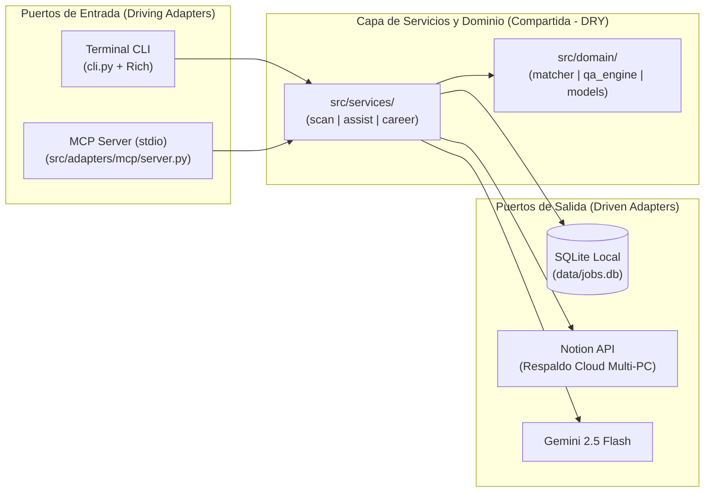

# 08. Servidor MCP Nativo (`Model Context Protocol`) y Sincronización Multi-PC

Este documento describe cómo `jobOS-bot` expone su capa de aplicación como un **Servidor MCP (`Model Context Protocol`)** local (`stdio`), permitiendo consultar tus postulaciones, métricas de mercado y preparación de entrevistas desde cualquier cliente de IA compatible (Antigravity, Claude Desktop, Claude Code, Cursor) en **cualquier PC**, además de brillar como diferenciador técnico en tu portafolio.

---

## 1. Por Qué un Servidor MCP Encaja Perfecto en Nuestra Arquitectura Hexagonal

Gracias a que el proyecto separa **`src/domain/`** y **`src/services/`** de la interfaz de usuario, el Servidor MCP no duplica ni una sola línea de lógica de negocio (**Puro DRY**). Es simplemente un **segundo puerto de entrada (Driving Adapter)** junto a `cli.py`:



---

## 2. Uso Desde Otro PC (Bootstrap Automático desde Notion)

Si descargas tu repositorio en **otro PC distinto** donde aún no existe el archivo `data/jobs.db`:
1. Configuras únicamente tu `.env` con `NOTION_TOKEN`, `NOTION_DATABASE_ID` y `GEMINI_API_KEY`.
2. Al invocar la herramienta MCP `sync_pipeline_with_notion` (o `python cli.py sync`), si SQLite está vacío, el sistema hace un **Pull / Bootstrap completo desde tu base de datos de Notion**, reconstruyendo localmente tus vacantes, estados, porcentajes de `Match %` y el contador `times_applied`.
3. A partir de ese segundo, puedes hacerle preguntas a la IA sobre todas tus postulaciones desde el nuevo PC.

---

## 3. Diseño de Herramientas MCP (Siguiendo `mcp-server-builder`)

Aplicando las buenas prácticas de diseño de herramientas para LLMs (*"Name the job, not the endpoint"*, respuestas compactas en Markdown, separación clara entre lectura y escritura, y todos los logs a `stderr` para no contaminar `stdout`):

| # | Nombre de la Tool MCP | Tipo | Qué Pregunta Real Responde |
| :--- | :--- | :--- | :--- |
| **1** | `get_pipeline_overview` | Lectura | *"¿Cómo va mi búsqueda de trabajo esta semana? ¿Cuántas postulaciones y re-postulaciones llevo y cuáles requieren seguimiento?"* |
| **2** | `search_applications` | Lectura | *"Muéstrame las vacantes remotas con `Match >= 60%` o busca cuántas veces me he postulado a la empresa X (`times_applied`)."* |
| **3** | `get_market_stack_radar` | Lectura | *"Según todas las ofertas analizadas, ¿qué tecnologías de mi stack están pidiendo más en el mercado?"* |
| **4** | `prepare_job_application_kit` | Lectura / IA | *"Para la vacante `#14`, dime qué keywords le faltan a mi CV (`tailor`) y genérame las preguntas técnicas de entrevista (`prep`)."* |
| **5** | `sync_pipeline_with_notion` | Escritura / Sync | *"Sincroniza mi base de datos con Notion (o descarga mis postulaciones desde Notion en este PC nuevo) y dime si hay follow-ups pendientes."* |

---

## 4. Configuración en Clientes de IA (Para el `README.md` del Portafolio)

Cualquier reclutador o desarrollador que revise tu repositorio verá cómo conectarlo en segundos en su configuración de MCP (`mcp_config.json` / `claude_desktop_config.json`):

```json
{
  "mcpServers": {
    "jobos-bot": {
      "command": "python",
      "args": ["-m", "src.adapters.mcp.server"],
      "cwd": "C:/Users/alejandro/developer/jobOS-bot"
    }
  }
}
```

