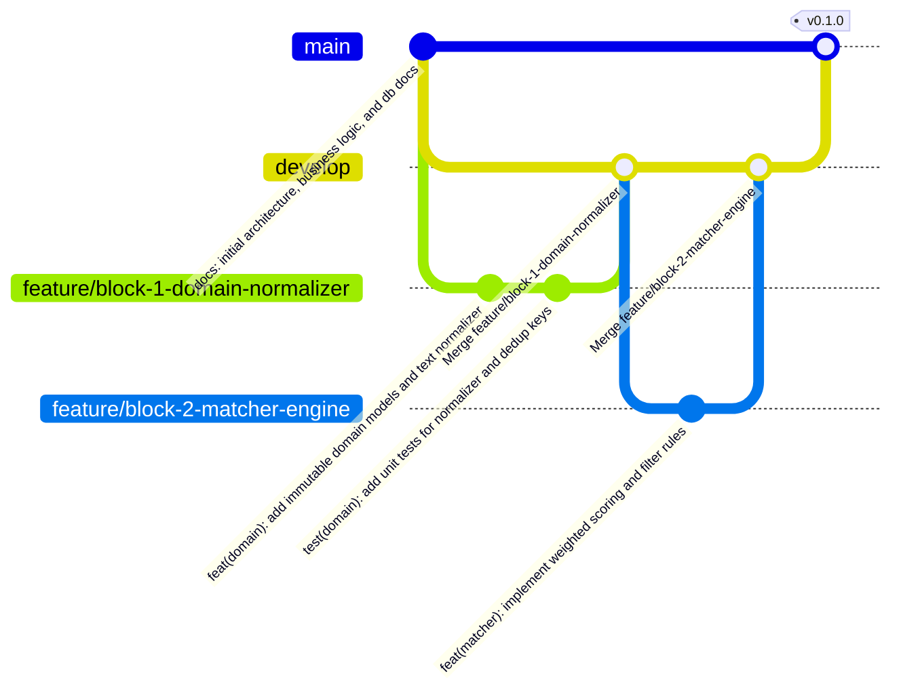

# 10. Flujo de Trabajo Gitflow y Convenciones de Commits

Este documento define la estrategia de ramificación (**Gitflow**) y el estándar de mensajes de commit (**Conventional Commits**) utilizados en el desarrollo de `jobOS-bot` para mantener un historial de versiones limpio, auditable y con estándar de ingeniería de portafolio.

---

## 1. Estructura de Ramas (Gitflow)



### Roles de Cada Rama

| Tipo de Rama | Nomenclatura | Propósito y Reglas |
| :--- | :--- | :--- |
| **Producción** | `main` | Contiene únicamente versiones estables, documentadas y con el 100% de los tests pasando. Nunca se programa directamente sobre `main`. |
| **Integración** | `develop` | Rama base de desarrollo donde convergen los 6 bloques funcionales a medida que se completan y aprueban sus pruebas. |
| **Funcionalidades (Bloques)** | `feature/block-<N>-<slug>` | Se crea desde `develop` para implementar cada bloque del `PLAN.md` (ej. `feature/block-1-domain-normalizer`). Se fusiona a `develop` con `git merge --no-ff` únicamente cuando `pytest` pasa al 100%. |
| **Documentación** | `docs/<slug>` | Cambios exclusivos de arquitectura, diagramas o manuales técnicos. |
| **Correcciones Críticas** | `hotfix/<slug>` | Correcciones urgentes (por ejemplo, actualización de un selector CSS roto en un portal) nacidas desde `main` y fusionadas tanto a `main` como a `develop`. |
| **Lanzamientos** | `release/vX.Y.Z` | Preparación de versión estable antes de hacer merge final a `main` con su etiqueta (`git tag vX.Y.Z`). |

---

## 2. Mapeo de Ramas `feature/*` con los 6 Bloques de `PLAN.md`

1. `feature/block-1-domain-normalizer` — Configuración base, modelos inmutables (`models.py`), normalizador (`text_normalizer.py`) y tests unitarios.
2. `feature/block-2-matcher-scoring` — Reglas declarativas (`filters.yaml`), cargador tipado y motor de scoring (`matcher.py` con umbral `>= 40%`).
3. `feature/block-3-sqlite-repository` — Esquema relacional 3FN (`schema.sql`), `ApplicationRepository` y lógica de re-postulación (`times_applied + 1`).
4. `feature/block-4-qa-fuzzy-engine` — Semilla de perfil (`profile.example.yaml`) y motor `RapidFuzz >= 85%` (`qa_engine.py`).
5. `feature/block-5-multiportal-scrapers` — `BasePortalScraper`, los 6 adaptadores *single-thread*, `scan_service.py` y CLI con `Rich`.
6. `feature/block-6-ai-notion-mcp-cloud` — `assist`, `GeminiClient`, `NotionClient` (Multi-PC), `MCP Server` (`stdio`), `Dockerfile` y GitHub Actions.

---

## 3. Estándar de Mensajes de Commit (Conventional Commits en Inglés)

Siguiendo las reglas de `ai-code-gen-guidelines`, todos los mensajes de commit se escriben en **inglés** con el formato:

```text
<type>(<scope>): <imperative summary in lowercase>
```

### Tipos Permitidos (`<type>`)
* `feat`: Nueva funcionalidad o módulo (ej. `feat(domain): implement canonical url and dedup key normalizer`).
* `test`: Adición o actualización de pruebas unitarias en `pytest` (ej. `test(normalizer): verify company suffix stripping and url cleaning`).
* `docs`: Documentación de arquitectura, lógica de negocio, base de datos o `README.md`.
* `refactor`: Mejora de código aplicando DRY/KISS sin alterar el comportamiento externo.
* `fix`: Corrección de un bug o selector DOM.
* `chore` / `ci`: Configuración de entorno, `.gitignore`, `Dockerfile` o workflows de GitHub Actions.
