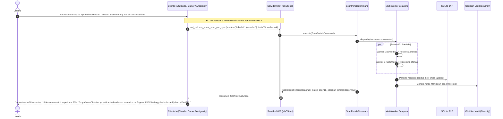
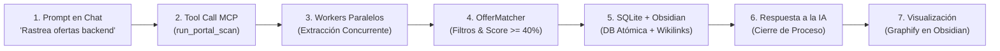
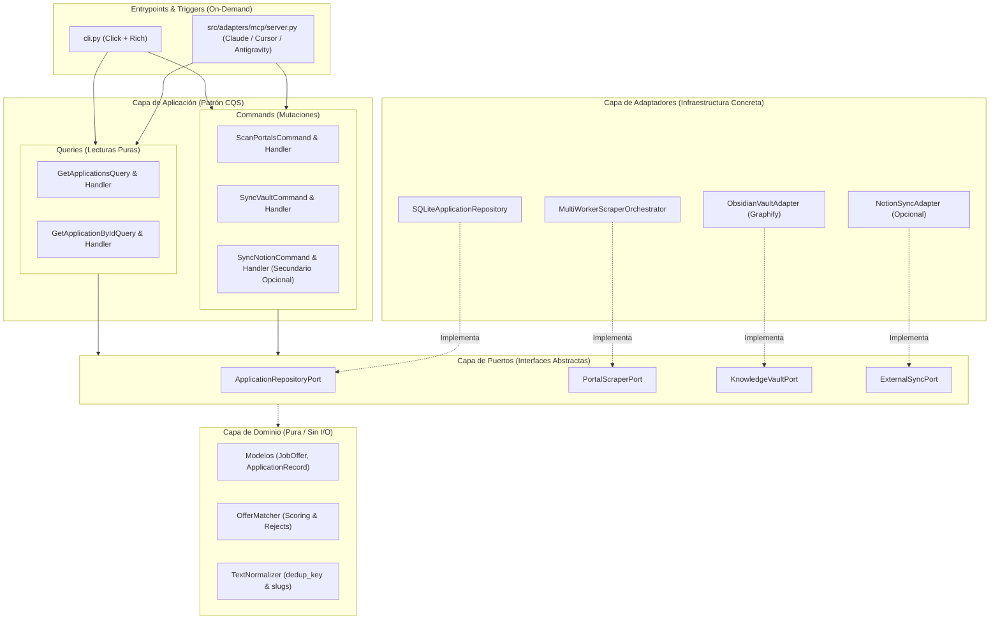
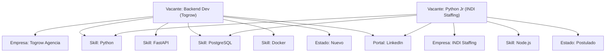

# 🏛️ 11. Redefinición Arquitectónica v2.0: Clean Architecture, CQS, Multi-Worker, Grafo en Obsidian y Activación On-Demand via MCP

Este documento define la evolución estratégica y técnica de `jobOS-bot` hacia un **Motor Concurrente de Inteligencia Laboral con Base de Datos en Grafo Local (Obsidian + Graphify)**, bajo **Clean Architecture**, **Ports & Adapters**, el patrón **CQS (Command Query Separation)** y activación **Zero-Daemon On-Demand via MCP**.

---

## 1. La Gran Analogía: De un Cadete Solitario a un Cuartel de Inteligencia Táctica

### El Modelo Antiguo (v1.0): El Cadete Solitario y la Libreta en la Nube
En la versión 1.0, el bot funcionaba como un **cadete solitario**:
1. Iba a la primera oficina de correos (LinkedIn). Esperaba la fila.
2. Si la fila tardaba o había un control policial (Captcha/Cloudflare), todo su día se congelaba.
3. Luego iba a la segunda oficina (Computrabajo) y a la tercera (GetOnBrd), una tras otra en un solo hilo a paso lento.
4. Para anotar lo que encontraba, dependía de enviar cartas a un archivador remoto en otro país (Notion API). Si la conexión fallaba, la API respondía lento o cambiaba una propiedad, el archivador no guardaba nada.
5. Intentaba meterse a rellenar formularios con marcadores de colores (`assist`), rompiéndose ante el menor cambio de diseño web del portal y requiriendo supervisión constante.
6. Tenía que estar despierto 24/7 en guardia (daemons, cron jobs continuos), consumiendo energía de fondo innecesariamente.

### El Nuevo Modelo (v2.0): El Cuartel General de Inteligencia y el Agente Durmiente
En la versión 2.0, `jobOS-bot` se transforma en una **Unidad Táctica de Inteligencia On-Demand**:
1. **El Agente Durmiente On-Demand (Zero-Daemon):** Ya no hay un centinela patrullando 24 horas al día sin motivo. El sistema duerme plácidamente a costo **cero de CPU/RAM**. Solo cuando tú o tu asistente de IA (Claude, Cursor, Antigravity) pulsan el intercomunicador vía **MCP (Model Context Protocol)**, el escuadrón despierta al instante.
2. **Escuadrón de Exploradores Paralelos (Multi-Worker):** Despachas a 4 o 6 exploradores especializados en simultáneo. El explorador de LinkedIn, el de GetOnBrd y el de Computrabajo rastrean el terreno a la vez. Si uno encuentra un control policial, los demás continúan su misión sin retrasarse.
3. **Cero Complejidad Inútil (Sin `assist` ni Auto-Submit):** Eliminamos cualquier intento frágil de manipular formularios web ajenos. El bot se enfoca en lo que aporta verdadero apalancamiento: rastreo masivo, filtrado implacable por stack y salario, y catalogación inteligente.
4. **Separación de Cocina y Menú (Patrón CQS):** Quien registra y procesa las pistas (Commands) trabaja de forma totalmente independiente de quien consulta el estado de las misiones (Queries).
5. **El Tablero de Investigación Táctica (Obsidian + Graphify):** En tu cuartel local tienes un **tablero de corcho gigante con chinchetas e hilos rojos**. Cada vacante es una ficha que se conecta instantáneamente mediante hilos (`[[Wikilinks]]`) con la empresa, con su nivel salarial y con cada tecnología requerida (`[[Python]]`, `[[FastAPI]]`, `[[Docker]]`). 
6. **Decisión Humana al Disparar:** El escuadrón te entrega el mapa completo, las brechas técnicas y los enlaces directos; tú decides con un solo clic cuándo y cómo postularte de forma limpia.

---

## 2. Comparativa Estratégica: v1.0 vs v2.0

| Dimensión | jobOS-bot v1.0 (Anterior) | jobOS-bot v2.0 (Nueva Definición) |
| :--- | :--- | :--- |
| **Ciclo de Vida del Proceso** | Demonio o Cron continuo 24/7 en segundo plano. | **Zero-Daemon On-Demand via MCP:** Cero consumo en reposo. Se activa únicamente por llamada de herramienta desde tu IA o por CLI puntual. |
| **Concurrencia de Escaneo** | Hilo único secuencial (*Single-Thread*). Lento y vulnerable a cuellos de botella. | **Multi-Worker Concurrente** (`ThreadPoolExecutor` con contextos Playwright aislados). 4x a 6x más rápido. |
| **Base de Datos Visual** | Notion API (requiere token, base de datos en nube, propensa a latencia de red). | **Obsidian Vault Local + Graphify** (100% offline, Markdown nativo, sin dependencias externas). |
| **Estructura de Datos Visual** | Tabla Kanban plana de Notion. | **Grafo Interactivo de Nodos** con relaciones bidireccionales (`[[Empresa]]`, `[[Tech]]`, `[[Estado]]`). |
| **Postulación Web** | Comando `assist` intentando pintar formularios DOM con colores. | **Click-and-Apply Directo desde Obsidian:** Enlaces limpios y canónicos listos para que apliques sin intermediarios frágiles. |
| **Patrón Arquitectónico** | Servicios monolíticos de aplicación acoplados a SQLite y Notion. | **Clean Architecture + CQS + Ports & Adapters** (Dominio puro, Comandos y Queries desacoplados). |
| **Comandos de CLI** | 8 comandos hinchados (`stats`, `tailor`, `prep`, `assist`, etc.). | **4 comandos nucleares y ultra-rápidos** (`scan`, `sync`, `auth`, `export`). |

---

## 3. Activación On-Demand via Servidor MCP (Zero-Daemon)

En lugar de mantener un proceso en segundo plano consumiendo recursos del sistema o exponiéndose a ser detectado por escaneos periódicos robóticos, el nuevo flujo está impulsado por **eventos conversacionales con tu Asistente de IA**.



### Herramientas MCP Clave Expuestas al LLM:

1. **`run_portal_scan_and_sync` (Command):**
   * **Parámetros:** `portals: list[str]`, `limit_per_portal: int = 15`, `workers: int = 4`, `sync_obsidian: bool = True`.
   * **Efecto:** Despierta el pool concurrente, barre los portales, filtra por match (`>= 40%`), persiste en SQLite y genera los archivos `.md` en el Vault de Obsidian.
   * **Retorno:** Resumen conciso con estadísticas de la misión.
2. **`query_job_applications` (Query):**
   * **Parámetros:** `status: str | None`, `min_match: int | None`, `keyword: str | None`.
   * **Efecto:** Permite al LLM responder preguntas analíticas: *"¿A qué empresas he postulado que exigen Docker?"* o *"¿Cuáles son las 3 mejores vacantes encontradas hoy?"*.
3. **`sync_obsidian_vault` (Command):**
   * **Parámetros:** `vault_path: str = "vault/"`.
   * **Efecto:** Reconstruye o regenera el grafo de Obsidian completo a partir de la base de datos SQLite.

---

## 4. Línea de Tiempo y Casos de Uso (Flujo Operativo)

### Línea de Tiempo: De la Petición Conversacional al Grafo Visual



---

### Casos de Uso del Candidato

#### Caso de Uso 1: Activación Conversacional desde Claude Desktop o Cursor
* **Situación:** Estás trabajando en tu editor de código o chateando con tu IA y decides actualizar tu pipeline de oportunidades.
* **Flujo:**
  1. Escribes en el chat: *"Por favor escanea ofertas de Junior Backend en Computrabajo y LinkedIn con 4 workers y déjamelas en mi Obsidian"*.
  2. Tu cliente de IA reconoce la herramienta MCP `run_portal_scan_and_sync` y la invoca con los argumentos adecuados.
  3. En segundo plano, se lanzan los navegadores en modo headless, extraen las ofertas, aplican la regla de deduplicación atómica y crean las notas en `vault/applications/`.
  4. Tu IA te responde en lenguaje natural con los hallazgos principales y las empresas más destacadas.
  5. Cero comandos en terminal, cero demonios corriendo en segundo plano: **pura interacción Just-In-Time**.

---

#### Caso de Uso 2: El Grafo de Conocimiento y Brechas Técnicas (Obsidian + Graphify)
* **Situación:** Quieres planificar qué tecnologías estudiar para maximizar tu empleabilidad en el mercado actual.
* **Flujo:**
  1. Abres la carpeta `vault/` en Obsidian y activas la vista de grafo (**Graph View** o plugin **Graphify**).
  2. **Descubrimiento visual inmediato:**
     * Alrededor del nodo `[[Python]]` orbitan 14 ofertas de empleo.
     * El nodo `[[FastAPI]]` conecta 10 de esas ofertas directamente con empresas remotas.
     * El nodo `[[Docker]]` se conecta de forma transversal tanto a ofertas de Python como de Node.js.
     * En rojo o amarillo, los nodos de brechas técnicas (`[[Redis]]`, `[[AWS]]`, `[[Celery]]`) te muestran exactamente qué conceptos te faltan para alcanzar el 90% de match.
  3. Al hacer clic en cualquier nodo de vacante, lees el resumen, ves el enlace oficial y aplicas directamente con tu CV preparado.

---

#### Caso de Uso 3: Postulación Quirúrgica Directa desde la Nota (Click-and-Apply)
* **Situación:** Has identificado una vacante con 95% de match en tu Grafo de Obsidian y quieres postularte de inmediato.
* **Flujo:**
  1. Haces clic en el nodo de la vacante dentro de Obsidian.
  2. La nota contiene el enlace limpio y canónico (`url`) junto con el resumen de los requisitos exactos de la empresa.
  3. Haces clic en el enlace: se abre tu navegador habitual con tu sesión real iniciada.
  4. Envías tu CV en menos de 30 segundos sin depender de scripts frágiles ni lidiar con bloqueos de automatización.
  5. En la misma nota de Obsidian, cambias el frontmatter `status: Postulado` y el nodo se reorganiza automáticamente en tu grafo.

---

## 5. Arquitectura Limpia: Capas, Ports & Adapters y CQS



### Explicación de la Separación CQS (Command Query Separation)

> [!NOTE]
> **Analogía CQS:** En un restaurante elegante, la **Comanda** que entra a la cocina para preparar un plato cambia el estado del inventario y la cuenta del cliente (un **Command**). En cambio, leer la **Carta o Menú** no gasta ingredientes ni cobra un solo centavo (una **Query**). Jamás mezclas cocinar un bistec con leer la carta.

1. **Commands (Escritura / Modificación):**
   * Modifican el estado de la base de datos o generan archivos en el disco.
   * Devuelven un reporte de ejecución o estado (`Result[Success, Error]`), pero no conjuntos complejos de datos manipulables.
   * Ejemplos: `ScanPortalsCommand`, `SyncVaultCommand`.
2. **Queries (Lectura Pura):**
   * Consultan datos sin alterar absolutamente nada en la base de datos ni en el vault de Obsidian.
   * Son idempotentes y de ejecución segura en cualquier momento.
   * Ejemplos: `GetApplicationsQuery`, `GetApplicationByIdQuery`.

---

## 6. El Modelo de Base de Datos en Obsidian + Graphify

La base de datos local en Obsidian se estructura para maximizar la navegación visual:

```
vault/
├── applications/                         # Registro detallado de cada oportunidad
│   ├── togrow-agencia_backend-developer.md
│   └── indi-staffing_python-developer-junior.md
├── companies/                            # Hubs por empresa contratante
│   ├── togrow-agencia.md
│   └── indi-staffing.md
├── skills/                               # Hubs por tecnología para clústeres de grafo
│   ├── python.md
│   ├── fastapi.md
│   ├── postgresql.md
│   ├── docker.md
│   └── redis.md
├── portals/                              # Nodos de origen de búsqueda
│   ├── linkedin.md
│   ├── getonbrd.md
│   └── computrabajo.md
└── status/                               # Nodos por etapa del proceso
    ├── nuevo.md
    ├── postulado.md
    ├── entrevista.md
    └── descartado.md
```

### Estructura de Relaciones en el Grafo (Graphify)



---

## 7. Matriz de Comandos CLI Depurados

Hemos depurado radicalmente la CLI, eliminando todos los comandos que añadían fricción o eran innecesarios:

| Comando | Estado | Propósito y Banderas Clave |
| :--- | :---: | :--- |
| `python cli.py scan` | **Activo (Optimizado)** | Escaneo multi-worker concurrente puntual. Soporta `--workers N`, `--portal <nombre>`, `--limit N`, `--vault-dir <path>`. |
| `python cli.py sync` | **Activo (Optimizado)** | Sincroniza y reconstruye el Vault de Obsidian (`--target obsidian`, por defecto) o Notion (`--target notion`, secundario). |
| `python cli.py auth` | **Activo (Optimizado)** | Modo visible para iniciar sesión manual y guardar cookies anti-detección (`python cli.py auth glassdoor`). |
| `python cli.py export` | **Activo** | Exporta la base de datos a `json` o `csv` para reportes externos. |
| `python cli.py assist` | ❌ **Eliminado (Inútil y Frágil)** | **Decisión técnica:** Inyectar bordes de colores en formularios web externos aportaba una enorme fragilidad técnica ante cambios de selectores CSS y generaba lentitud manual innecesaria. Se sustituye por el flujo superior de **Click-and-Apply directo desde las notas de Obsidian**, donde el usuario accede al link limpio con su propio navegador sin scripts intrusivos. |
| `python cli.py stats` | ❌ **Eliminado** | Reemplazado por la visualización orgánica del grafo interactivo en Obsidian + Graphify. |
| `python cli.py tailor` | ❌ **Eliminado** | No requerido en esta fase. |
| `python cli.py prep` | ❌ **Eliminado** | No requerido en esta fase. |

---

## 8. Análisis de Complejidad Computacional, Correcciones Algorítmicas y Mejoras de Alto Impacto

### Notación Asintótica:
* $n$: longitud del texto de la oferta.
* $m$: longitud del patrón o palabra clave.
* $L$: longitud de una pregunta de formulario.
* $N$: tamaño del banco de preguntas o registros en la base de datos.
* $T$: número de tecnologías en el vocabulario.
* $V, E$: vértices (nodos) y aristas (enlaces) en el grafo de Obsidian.
* $w = 64$: tamaño de palabra de CPU (arquitectura de 64 bits).

### Matriz de Complejidad por Componente

| Componente | Tiempo | Espacio | Observación Algorítmica |
| :--- | :--- | :--- | :--- |
| **Levenshtein / Indel (RapidFuzz)** | $O(\lceil m/w \rceil \cdot n) \approx O(n)$ si $m \le 64$ | $O(\lceil m/w \rceil)$; $O(m \cdot n)$ solo con editops | Algoritmo bit-paralelo de Hyyrö + bandas de Ukkonen. |
| **Token Set / Sort Ratio** | $O(L + t \log t + L^2/w)$ | $O(L)$ | Tokenización, ordenamiento de tokens y distancia sobre conjuntos. |
| **Regex en Python (`re`)** | Típico $O(n \cdot m)$; peor caso exponencial | $O(m)$ patrón + $O(n)$ pila | Motor de **backtracking** (NFA con retroceso, NO un DFA puro). |
| **Scoring Ponderado** | $O(T_{\text{oferta}})$ con set; $O(T \cdot n)$ con una regex/tech | $O(T)$ | Evaluación lineal de intersección de conjuntos. |
| **B-Tree (SQLite)** | $O(\log_b N)$, con $b \approx 100\text{--}500$ (2 a 4 lecturas de página) | $O(N \cdot |\text{clave}|)$ | Búsqueda balanceada en disco sobre índice `UNIQUE`. |
| **Grafo + Fruchterman-Reingold** | $O(I \cdot (V^2 + E))$; con Barnes-Hut (D3): $O(I \cdot (V \log V + E))$ | $O(V + E)$ | Simulación física de fuerzas iterativa en Obsidian. |

---

### Análisis Crítico por Componente y Mejoras

#### 1. Búsqueda Difusa (*Fuzzy Matching*)
* **Realidad Algorítmica:** `RapidFuzz` implementa el algoritmo bit-paralelo de Hyyrö, lo que en la práctica resulta lineal para textos cortos. Con `score_cutoff` utiliza bandas de Ukkonen para abortar tempranamente si la cota superior no supera el umbral. Comparar contra todo el banco cuesta $O(N \cdot L)$, que para cientos de preguntas es despreciable.
* **Correcciones Técnicas:**
  * `fuzz.ratio` calcula la **distancia Indel** (únicamente inserciones y eliminaciones con costo uniforme), no la distancia de Levenshtein clásica (que incluye sustitución con costo 1).
  * `token_set_ratio` produce score $100$ siempre que un conjunto de tokens sea subconjunto estricto del otro. Por ejemplo, *"Salario esperado"* vs *"Salario esperado en USD si trabajas remoto"* arroja $100\%$, representando un potencial falso positivo si no se parametriza con cautela.
  * La similitud difusa solo es robusta si se normalizan tildes y signos (`processor=utils.default_process`).
* **Diseño Óptimo en Cascada:**
  1. **Nivel 1 — Hash Exacto ($O(1)$):** Comparación directa sobre la pregunta normalizada en un diccionario en memoria.
  2. **Nivel 2 — Plantilla Heurística ($O(L)$):** Detección de intenciones parametrizadas mediante slots (ej. `años.*experiencia.*{tecnología}`).
  3. **Nivel 3 — RapidFuzz con Umbral Alto:** Evaluación difusa con cutoff $\ge 85\%$.
  4. **Nivel 4 — Embeddings Semánticos (Respaldo):** Vectores densos multilingües (ej. `multilingual-e5-small`) con pre-cálculo offline; la consulta cuesta $O(N \cdot d)$ con producto punto o $O(\log N)$ con HNSW si el volumen escala.

#### 2. Expresiones Regulares y Tokenización
* **Corrección de Motor:** El módulo `re` de Python es un motor de **backtracking** (NFA con retroceso), no un Autómata Finito Determinista (DFA). Dado que los *lookarounds* (`(?<=...)`, `(?<!...)`, `(?=...)`, `(?!...)`) no son operaciones regulares puras, no pueden compilarse a un DFA clásico. Cuantificadores anidados sobre textos extensos pueden detonar retroceso catastrófico.
* **El Problema de los Símbolos (`\b`):** La aserción de límite de palabra `\b` falla en términos terminados en símbolo (`C#`, `C++`, `.NET`) porque `#`, `+` y `.` no son considerados caracteres de palabra (`\w`).
* **Patrones Precisos con Lookarounds:**
  ```python
  C_SHARP = re.compile(r'(?<!\w)c#(?!\w)', re.IGNORECASE)
  DOT_NET = re.compile(r'(?<![\w.])\.net\b', re.IGNORECASE)   # Rechaza falsos como "empresa.net"
  JS      = re.compile(r'(?<![\w.])js(?!\w)', re.IGNORECASE)  # Rechaza "json", "rxjs", "node.js"
  ```
* **Alternativa de Alto Rendimiento ($O(n)$):**
  En lugar de ejecutar $T$ expresiones regulares secuenciales ($O(T \cdot n)$), tokenizar el texto una sola vez mediante un lexer o regex que conserve caracteres `#+.-` dentro del token, y buscar cada token en una tabla hash de alias normalizados en $O(1)$:
  $$\text{"js"} \rightarrow \text{"JavaScript"}, \quad \text{".net"} \rightarrow \text{"DotNet"}, \quad \text{"c#"} \rightarrow \text{"CSharp"}$$
  Para términos de múltiples palabras (ej. *"REST API"*, *"Amazon Web Services"*), la solución asintóticamente óptima es el algoritmo de **Aho-Corasick** (`pyahocorasick`), con complejidad $O(n + z)$ donde $z$ es el número de coincidencias.
* **Regla de Rechazo Duro (*Hard Rejects*):**
  Las listas negras de exclusión (*Senior*, *Lead*, *Staff*) deben evaluarse **únicamente sobre el título del cargo**, nunca sobre el cuerpo de la descripción, evitando falsos descartes ante frases como *"trabajarás de la mano con un Senior Architect"*.

#### 3. Scoring Ponderado
* **Corrección de Porcentajes:** La terna de pesos Core ($3$), Secundario ($2$) y Bonus ($1$) sobre una suma total de $6$ produce una distribución teórica de $50\%$, $33.3\%$ y $16.7\%$ (no $50/30/20$).
* **Fórmula con Suavizado Bayesiano (en lugar de piso heurístico):**
  En lugar de un piso condicional discontinuo, se aplica suavizado bayesiano con un prior $p_0$:
  $$\text{Score} = \frac{\sum_{i} \text{peso}_i \cdot \text{match}_i + \alpha \cdot p_0}{\sum_{i} \text{peso}_i + \alpha}$$
  *Para ofertas con descripciones muy breves, el score se contrae suavemente hacia el prior $p_0$ ponderado por $\alpha$; para descripciones detalladas con abundante evidencia, los términos dominan limpiamente sin saltos artificiales.*
* **Ponderación por Rareza (IDF):**
  Asignar mayor peso a tecnologías escasas o distintivas mediante Inverse Document Frequency calculada desde el corpus propio de vacantes:
  $$\text{IDF}(t) = \log \left( \frac{N_{\text{total vacantes}}}{1 + N_{\text{vacantes con } t}} \right)$$
* **Aprendizaje Supervisado:**
  Con el registro histórico de respuestas (postulaciones que avanzaron a entrevista vs descartes), entrenar un clasificador logístico ligero sobre el vector binario de tecnologías presentes; la inferencia permanece en $O(T)$.

#### 4. Deduplicación y Persistencia en SQLite
* **Atomicidad con UPSERT:**
  Garantizar idempotencia y concurrencia segura mediante la sintaxis nativa de SQLite (requiere restricción `UNIQUE` sobre `dedup_key`):
  ```sql
  INSERT INTO applications (dedup_key, title, company, match_score, times_applied)
  VALUES (?, ?, ?, ?, 1)
  ON CONFLICT(dedup_key) DO UPDATE SET
    times_applied = times_applied + 1,
    last_applied_at = CURRENT_TIMESTAMP;
  ```
* **Índice B-Tree Compuesto:**
  Sustituir la clave concatenada por un índice compuesto sobre `(company_norm, title_norm)`. Esto permite que el mismo índice B-Tree sirva para búsquedas por empresa en $O(\log N)$.
* **Técnica de *Blocking*:**
  Para evitar duplicados por variaciones sintácticas leves (*"Backend Developer (Python)"* vs *"Desarrollador Backend Python"*), aplicar *blocking*: buscar por `company_norm` en el B-Tree en $O(\log N)$ y comparar la lista reducida de cargos de esa empresa mediante `fuzz.token_sort_ratio`.

#### 5. Teoría de Grafos y Análisis Estructural (Obsidian + Graphify)
* **Visualización vs Computación:**
  Construir el grafo es $O(V + E)$. El algoritmo de fuerzas de Obsidian (D3-force con aproximación de Barnes-Hut) es exclusivamente una técnica de renderizado estético que degrada su rendimiento por encima de $\sim 5{,}000$ nodos.
* **Métricas Estructurales de Alto Valor:**
  1. **Proyección Unipartita Skill-to-Skill:** Proyectar la red bipartita (Vacante $\leftrightarrow$ Skill) hacia una red ponderada de co-ocurrencia entre tecnologías en $O(\sum d_v^2)$, donde $d_v \approx 10$ skills por vacante.
  2. **Detección de Comunidades (Louvain / Leiden):** En $O(E \log V)$, identifica clusters tecnológicos reales del mercado (ej. cluster FastAPI/PostgreSQL/Docker vs NestJS/TypeScript/Prisma).
  3. **Minería de Reglas de Asociación (FP-Growth):** Descubrir asociaciones frecuentes:
     $$\{\text{FastAPI}\} \implies \{\text{Python}, \text{Docker}, \text{PostgreSQL}\} \quad (\text{Confianza } \ge 90\%)$$
  4. **Matriz de Priorización de Aprendizaje:**
     $$\text{Prioridad}(s) = \text{Demanda}(s) \times (1 - \text{Nivel de Dominio}(s))$$

---

### Hoja de Ruta de Implementación por Impacto Técnico

1. **Prioridad 1 (Corrección & Rendimiento):** Tokenizador unificado con diccionario de alias para extraer tecnologías en $O(n)$ sin falsos positivos de límites de palabra.
2. **Prioridad 2 (Precisión de Formulario):** Cascada de matching para preguntas ($O(1) \rightarrow O(L) \rightarrow \text{Fuzzy}$).
3. **Prioridad 3 (Robustez de Persistencia):** B-Tree con índice compuesto y UPSERT atómico en SQLite con blocking por empresa.
4. **Prioridad 4 (Precisión de Scoring):** Scoring bayesiano suavizado con prior $p_0$ e IDF de tecnologías.
5. **Prioridad 5 (Inteligencia en Grafo):** Métricas de centralidad y co-ocurrencia en backend (Python), reservando Obsidian para la visualización táctica.

---

## 9. Plan de Implementación Técnica por Fases

1. **Fase 1: Capa de Puertos (`src/ports/`)**
   * `repository_port.py`: Interfaz abstracta para SQLite.
   * `scraper_port.py`: Interfaz abstracta para scrapers de portales.
   * `vault_port.py`: Interfaz abstracta para Obsidian Vault y generación de wikilinks.
   * `external_sync_port.py`: Interfaz abstracta para Notion (secundario).
2. **Fase 2: Adaptador de Obsidian (`src/adapters/obsidian/`)**
   * Implementación de `ObsidianVaultAdapter`.
   * Generación de notas Markdown con frontmatter YAML, tags y wikilinks `[[...]]`.
   * Creación automática de hubs para `companies/`, `skills/`, `portals/` y `status/`.
3. **Fase 3: Orquestador Multi-Worker (`src/adapters/scrapers/`)**
   * Implementación de `MultiWorkerScraperOrchestrator` usando `concurrent.futures.ThreadPoolExecutor`.
   * Gestión de contextos Playwright independientes por worker para evitar colisiones.
4. **Fase 4: Capa de Aplicación CQS (`src/application/`)**
   * Implementar `ScanPortalsCommand` y `ScanPortalsHandler`.
   * Implementar `SyncVaultCommand` y `SyncVaultHandler`.
   * Implementar Queries de solo lectura (`GetApplicationsQuery`).
5. **Fase 5: Actualización del Servidor MCP (`src/adapters/mcp/server.py`)**
   * Exponer la herramienta `run_portal_scan_and_sync` conectada directamente a `ScanPortalsCommand`.
   * Exponer `query_job_applications` y `sync_obsidian_vault`.
6. **Fase 6: CLI Depurada (Sin `assist`, `stats`, `tailor`, `prep`) y Pruebas Unitarias**
   * Depurar `cli.py` dejando únicamente los 4 comandos nucleares (`scan`, `sync`, `auth`, `export`).
   * Eliminar o desactivar `assist_service.py` y actualizar la suite `pytest`.
   * Validar con `pytest` y `mypy --strict`.
