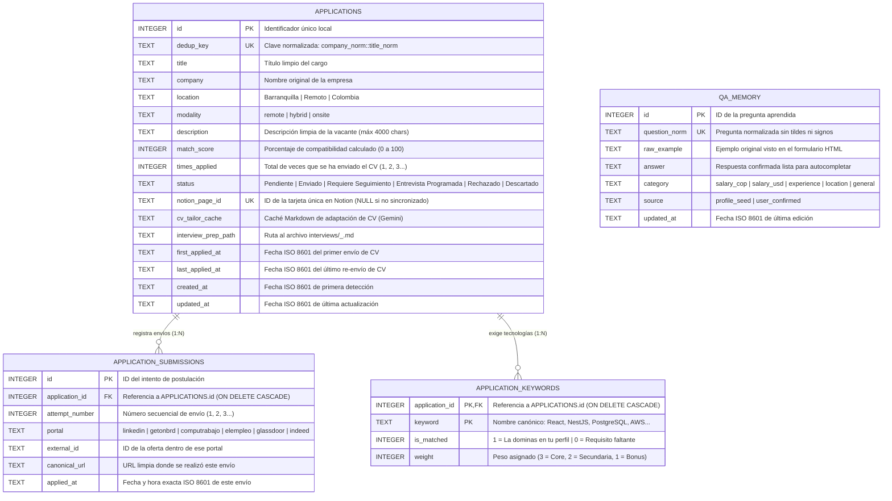

# 01. Modelo Entidad-Relación y Formas Normales (1FN, 2FN, 3FN)

Este documento explica el diseño relacional de `data/jobs.db` y cómo aplicamos las **Tres Formas Normales (1FN, 2FN, 3FN)** combinadas con **KISS** para resolver el requerimiento central del negocio: **permitir múltiples postulaciones a una misma vacante sin duplicar la oferta ni distorsionar las estadísticas de tecnologías.**

---

## 1. El Problema de NO Normalizar (Por Qué Diseñamos 4 Tablas)

Si guardáramos cada escaneo o postulación en una sola tabla plana sin normalizar, ocurrirían **3 anomalías graves**:
1. **Anomalía de Duplicación:** Si una misma vacante de *"Desarrollador Junior React"* en *"Acme"* aparece en LinkedIn, GetOnBrd y Computrabajo, tendrías 3 filas distintas en tu base de datos y 3 tarjetas repetidas en Notion.
2. **Anomalía de Estadísticas (`stats`):** Si te postulas 3 veces a esa misma oferta y cuentas las palabras clave directamente sobre los envíos, sumarías `+3` apariciones a `React` y `PostgreSQL` cuando en realidad se trata de **una sola vacante del mercado**.
3. **Anomalía de Estado:** Si la empresa te llama a entrevista y cambias el estado en una fila, las otras dos filas quedarían como *"Enviado"* y el bot seguiría mandando recordatorios de *follow-up* por error.

---

## 2. Aplicación Paso a Paso de las Formas Normales

### Primera Forma Normal (1FN — Atomicidad y Eliminación de Grupos Repetitivos)
* **Regla:** Cada columna debe contener valores atómicos (indivisibles) y no deben existir columnas repetidas como `portal_1, fecha_1, portal_2, fecha_2` ni listas separadas por comas dentro de una celda de texto para hacer consultas.
* **Cómo se aplica en `jobOS-bot`:**
  * Extraemos los múltiples envíos de una misma vacante a la tabla hija **`application_submissions`** (relación `1:N`).
  * Extraemos las tecnologías detectadas y faltantes de cada vacante a la tabla **`application_keywords`** (relación `1:N`).

### Segunda Forma Normal (2FN — Dependencia Funcional Completa de la Clave Primaria)
* **Regla:** Estar en 1FN y que todo atributo no clave dependa al 100% de la clave primaria completa (sin dependencias parciales en claves compuestas).
* **Cómo se aplica en `jobOS-bot`:**
  * En **`application_keywords`**, la clave primaria es compuesta: `(application_id, keyword)`. El atributo `is_matched` (si tú dominas o no esa tecnología en esa oferta) y `weight` dependen de la combinación exacta de la oferta y la tecnología, mientras que los datos propios de la vacante (`title`, `company`, `status`) viven únicamente en `applications`.

### Tercera Forma Normal (3FN — Sin Dependencias Transitivas)
* **Regla:** Estar en 2FN y que ningún atributo no clave dependa de otro atributo no clave.
* **Cómo se aplica en `jobOS-bot`:**
  * La URL específica de cada portal donde se publicó la oferta (`url`) y el `external_id` de ese portal dependen del **intento de envío en ese portal**, no de la vacante abstracta. Por eso viven en **`application_submissions`**, mientras que la identidad semántica de la vacante (`dedup_key`, `company`, `title`, `match_score`, `status`) vive en **`applications`**.
  * *Nota pragmática (Desnormalización controlada por rendimiento / KISS):* Mantenemos el contador entero `times_applied`, `first_applied_at` y `last_applied_at` en la tabla maestra `applications` sincronizados dentro de la misma transacción SQL para que las lecturas rápidas de la CLI y la sincronización con Notion no requieran `GROUP BY` costosos en cada listado.

---

## 3. Diagrama Entidad-Relación Completo (`erDiagram`)

---

## 4. Cómo Resuelve este Modelo las Consultas Clave del Negocio

1. **¿Cuántas veces me he postulado a esta vacante y por qué portales?**
   * Lees `applications.times_applied` en tiempo constante $O(1)$ y, si quieres ver el desglose histórico, consultas `SELECT attempt_number, portal, canonical_url, applied_at FROM application_submissions WHERE application_id = ?`.
2. **¿Cuáles son las tecnologías más pedidas del mercado (`python cli.py stats`) sin inflar números por re-postulaciones?**
   * Se consulta `SELECT keyword, COUNT(application_id) AS total_vacantes, SUM(is_matched) AS veces_cumplida FROM application_keywords GROUP BY keyword ORDER BY total_vacantes DESC`. Como `application_keywords` está ligada a `applications.id` (la vacante única) y no a `application_submissions`, **aunque te postules 4 veces a la misma vacante, cuenta exactamente como 1 vacante del mercado**.
3. **¿Qué requisitos me faltaban en la vacante `#12` para preparar la entrevista o adaptar mi CV?**
   * `SELECT keyword FROM application_keywords WHERE application_id = 12 AND is_matched = 0`.

