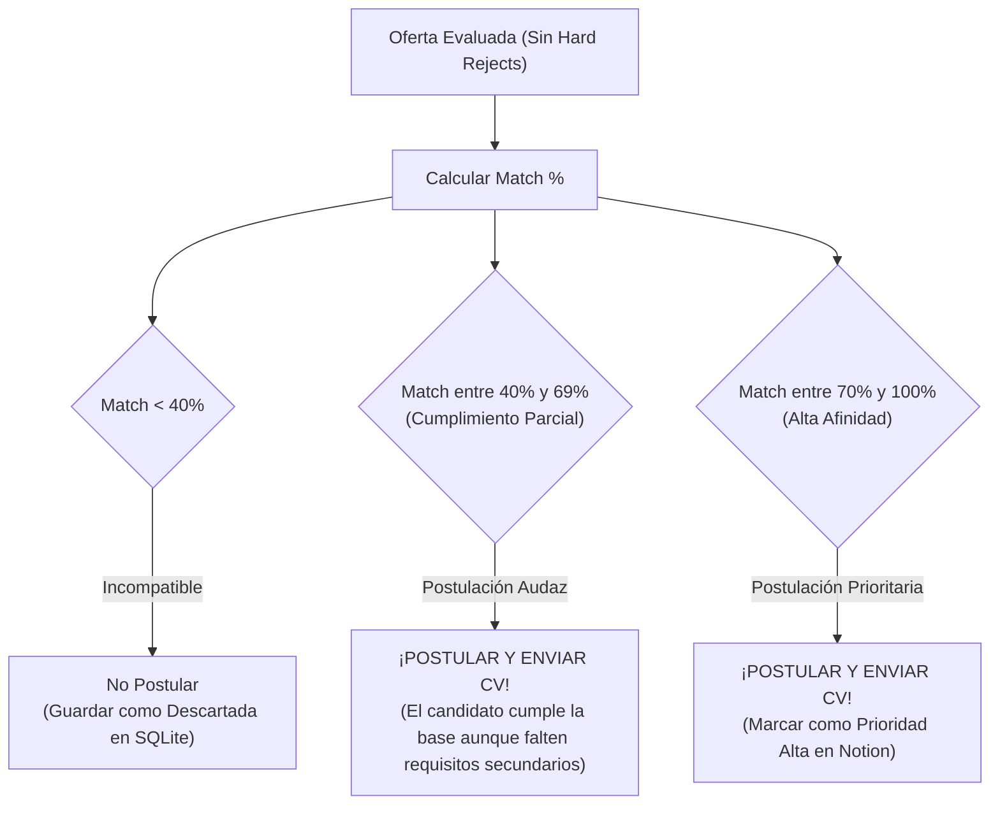

# 01. Motor de Scoring (%) y Regla de Postulación Flexible

En el mercado laboral de tecnología, las descripciones de cargos suelen ser "listas de deseos" infladas por Recursos Humanos. Esperar a cumplir el **100%** de los requisitos de una vacante reduce drásticamente las oportunidades de entrevista.

Por ello, la regla de negocio central de `jobOS-bot` es: **Si la oferta no viola un filtro excluyente duro y supera el umbral mínimo de compatibilidad (`>= 40%`), el bot envía la hoja de vida y se postula.**

---

## 1. Filtros Excluyentes Duros (*Hard Rejects*) vs. Requisitos Flexibles (*Soft Requirements*)

Antes de calcular el porcentaje, el bot separa lo que **imposibilita** el cargo de lo que es **negociable**:

| Tipo de Criterio | Ejemplos | Acción del Bot |
| :--- | :--- | :--- |
| **Hard Reject (Bloqueante)** | Título dice explícitamente `Senior`, `Lead`, `Architect`, `Manager`, `+5 años` obligatorios, o el rol es 100% de un lenguaje ajeno (`COBOL`, `SAP ABAP`, `iOS Swift nativo`) o presencial en otra ciudad fuera de Barranquilla. | **Descarte inmediato (`0%`)**. No gasta tiempo ni envía CV. |
| **Core Stack (Tuyo)** | `React`, `Node.js`, `NestJS`, `TypeScript`, `JavaScript`, `PostgreSQL`, `SQL`, `Next.js`, `Express`, `HTML/CSS`, `Tailwind`, `Git`, `REST API`. | **Suma puntos fuertes** al porcentaje de compatibilidad. |
| **Soft / Bonus Skills (Requisitos que quizá no cumples al 100%)** | La oferta pide además `AWS`, `Kubernetes`, `GraphQL`, `Redis`, `Microservicios`, `CI/CD`, `Docker`, `Python`, `MongoDB` o `2-3 años de experiencia`. | **No bloquean la postulación.** Aunque no tengas todos estos puntos, si el núcleo coincide dentro del rango de `%`, **se envía el CV igual**. |

---

## 2. Fórmula de Cálculo del Porcentaje de Compatibilidad (`Match %`)

Cada tecnología del diccionario (`config/filters.yaml`) tiene un peso asignado según qué tan central es para el rol:
* **Peso Core (`3 puntos`):** `React`, `Node.js`, `NestJS`, `TypeScript`, `JavaScript`, `PostgreSQL`.
* **Peso Secundario (`2 puntos`):** `Next.js`, `Express`, `SQL`, `Prisma`, `TypeORM`, `Docker`, `REST API`, `Git`, `Tailwind`.
* **Peso Complementario (`1 punto`):** `AWS`, `Redis`, `GraphQL`, `Jest`, `CI/CD`, `Linux`, `MongoDB`, `Python`, `Scrum`.

Cuando el scraper extrae una oferta, detecta el conjunto de tecnologías mencionadas en la oferta ($T_{\text{oferta}}$) y lo cruza contra las tecnologías que tú manejas en tu perfil ($T_{\text{perfil}}$):

$$\text{Match \%} = \text{round}\left( \frac{\sum_{t \in (T_{\text{oferta}} \cap T_{\text{perfil}})} \text{peso}(t)}{\sum_{t \in T_{\text{oferta}}} \text{peso}(t)} \times 100 \right)$$

### Regla de Piso para Ofertas con Descripciones Cortas
En portales como **Computrabajo** o **Elempleo**, muchas ofertas locales dicen únicamente *"Se busca Desarrollador Junior con conocimientos en JavaScript y SQL"* sin listar 10 tecnologías.
* Si $T_{\text{oferta}}$ tiene entre 1 y 2 tecnologías y al menos 1 pertenece a tu **Core Stack**, el sistema asigna un **`Match %` base de `65%`** para asegurar la postulación.

---

## 3. Rangos de Decisión por Porcentaje (Tiers de Acción)

### Detalle de los 3 Rangos
1. **Rango `< 40%` — Incompatible (No Postular):**
   * Ejemplo: Piden `.NET + Angular + Azure + SQL Server` y solo coincides en `SQL` y `Git` (`20%`). Se descarta.
2. **Rango `40% – 69%` — Cumplimiento Parcial ("Postulación Audaz"):**
   * Ejemplo: Piden `React + Node.js + TypeScript + AWS + Terraform + Kafka + GraphQL`. Tú cumples `React`, `Node.js` y `TypeScript` (el núcleo pesado del desarrollo diario), lo que da **`55%`**, pero no tienes `Terraform` ni `Kafka`.
   * **Regla de negocio:** **Se envía la hoja de vida y se postula de todos modos.** En roles Junior/Mid-temprano, las empresas contratan por el dominio del lenguaje/framework base (`React/Node/TS`) y enseñan la infraestructura interna.
3. **Rango `70% – 100%` — Alta Afinidad ("Match Ideal"):**
   * Ejemplo: Piden `React + NestJS + TypeScript + PostgreSQL + Docker`. Cumples casi todo (`85%–100%`).
   * **Regla de negocio:** Se envía la hoja de vida, se postula y se etiqueta como **Prioridad Alta** en SQLite y Notion para hacerle seguimiento cercano.

