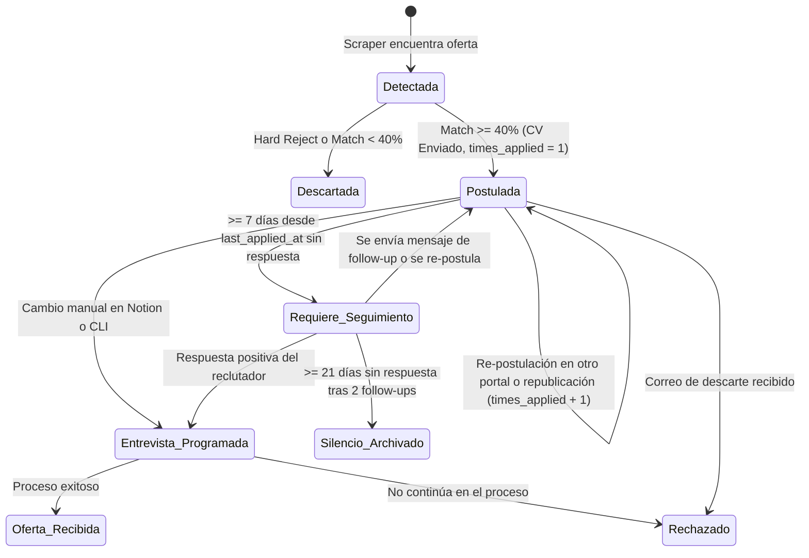

# 04. Máquina de Estados, Seguimiento y Entrevistas

Toda vacante procesada por `jobOS-bot` atraviesa un ciclo de vida único controlado en SQLite y reflejado en tu tablero de Notion.

---

## 1. Máquina de Estados de una Postulación

---

## 2. Reglas de Transición de Estados

| Estado Actual | Evento Disparador | Nuevo Estado | Acción Automática del Bot |
| :--- | :--- | :--- | :--- |
| **`Detectada`** | `match_score < 40%` o *Blacklist* | **`Descartada`** | Se registra localmente para no volver a abrir esa URL, pero **no se sube a Notion** para no ensuciar tu tablero. |
| **`Detectada`** | `match_score >= 40%` y envío de CV | **`Enviado / Postulada`** | Crea el registro único con `times_applied = 1` y lo sube a Notion en el próximo `sync`. |
| **`Enviado / Postulada`** | Se detecta la misma oferta de nuevo (cumpliendo `reapply_policy`) | **`Enviado / Postulada`** | Re-envía el CV, incrementa **`times_applied = times_applied + 1`**, actualiza `last_applied_at` y sincroniza el nuevo contador en Notion. |
| **`Enviado / Postulada`** | Pasan **`>= 7 días`** desde `last_applied_at` sin respuesta | **`Requiere Seguimiento`** | Cambia el estado en SQLite y Notion y genera el borrador de mensaje en `followups/pendientes.md`. |
| **Cualquiera** | Cambias el estado en Notion a **`Entrevista Programada`** | **`Entrevista Programada`** | **Congela re-postulaciones** para esa vacante y dispara automáticamente el generador de estudio técnico en `interviews/<id>_<empresa>.md`. |
| **Cualquiera** | Cambias el estado en Notion a **`Rechazado`** | **`Rechazado`** | **Congela re-postulaciones** para no volver a aplicar a un proceso donde ya te dieron respuesta negativa. |

---

## 3. Reglas de Seguimiento (Follow-up) y Relación con `times_applied`

El contador de días para seguimiento siempre se mide a partir de **`last_applied_at`** (la fecha de tu última postulación a esa vacante):

1. **Si el bot se re-postuló en el día 4** porque la vacante salió en un segundo portal (`times_applied = 2`), el reloj de los 7 días para el *follow-up* se reinicia desde esa segunda fecha de envío.
2. **Al cumplirse 7 días desde el último envío (`Follow-up #1`):**
   * El mensaje generado menciona que te postulaste al cargo de `<Título>` (y si `times_applied > 1`, tú sabes en qué portales aplicaste gracias a `submission_history`) y reitera tu interés destacando las 3 tecnologías principales en las que hiciste match.
3. **Al cumplirse 14 días desde el último envío (`Follow-up #2`):**
   * Genera un segundo recordatorio breve de cierre de ciclo.

